# Media Watch

[](LICENSE)
[](https://nodejs.org/)
[](#aplicaciones-cliente-y-compilaci%C3%B3n)
[-0078D6.svg?logo=windows&logoColor=white)](https://github.com/pacotegg/mediawatch/releases)
[](https://github.com/pacotegg/mediawatch/releases)
[](https://ko-fi.com/pacotegg)

[English](README.md) · [Español](README.es.md)

> ☕ **¿Te gusta el proyecto?** Si quieres apoyar el desarrollo continuo y ayudarme a mantenerlo, puedes [invitarme a un café en Ko-fi](https://ko-fi.com/pacotegg) o usar el botón **Sponsor** de arriba.

Creé Media Watch para el HTPC de mi salón porque quería un servidor de streaming rápido, visualmente cuidado y sin complicaciones que ofreciera una auténtica experiencia de cine en casa — sin telemetría, sin cuentas en la nube ni muros de pago.

Lee la biblioteca directamente desde tus discos duros o carpetas, indexa los metadatos y carátulas locales, y sirve el contenido a tu tele, móvil, tablet o navegador. Si el reproductor soporta el archivo original, hace **Direct Play directo** sin tocar el vídeo y con un consumo de CPU casi nulo. Si hace falta transcodificar (subtítulos quemados, reducción de bitrate fuera de casa o codecs incompatibles), aprovecha la aceleración por hardware de tu tarjeta gráfica.

> 💡 **¿Buscas instaladores listos para usar?**  
> - 💻 **Cliente de Escritorio (Windows, macOS y Linux)**: Descarga el reproductor nativo de alto rendimiento con Direct Play por GPU, HDR nativo y audio passthrough: **[Instalador Windows (.exe)](https://github.com/pacotegg/mediawatch/releases/tag/escritorio-v0.6.1)** · **[Instalador macOS (.dmg)](https://github.com/pacotegg/mediawatch/releases/tag/escritorio-v0.6.1)** · **[Linux AppImage y .deb](https://github.com/pacotegg/mediawatch/releases/tag/escritorio-v0.6.1)**  
> - 📱 **Móvil y Cast**: Descarga el APK de Android desde **[Releases](https://github.com/pacotegg/mediawatch/releases)** o desde la página `/instalar.html` de tu servidor.  
> - 🖥️ **Servidor de Escritorio Autónomo**: Echa un vistazo a **[MediaWatch Server](https://github.com/pacotegg/MediaWatch-Server)** si buscas un paquete de servidor todo en uno con icono en la bandeja del sistema, descarga automática de metadatos desde TMDb por nombre de archivo (sin necesidad de archivos `.nfo`) y emparejamiento con móvil mediante código QR. Este repositorio (`pacotegg/mediawatch`) es el motor central.

---

## Licencia GNU General Public License v3.0

Media Watch es software libre y de código abierto: puedes redistribuirlo y/o modificarlo bajo los términos de la **GNU General Public License versión 3.0 (GPLv3)** publicada por la Free Software Foundation. Consulta [LICENSE](LICENSE) para ver los términos completos.

---

## Capturas y Aspecto Visual

### Cliente Web (React 19 + Tailwind CSS)

| Portada Interactiva y Tráiler de Fondo | Ficha Técnica y Steelbook 3D |
|:---:|:---:|
| 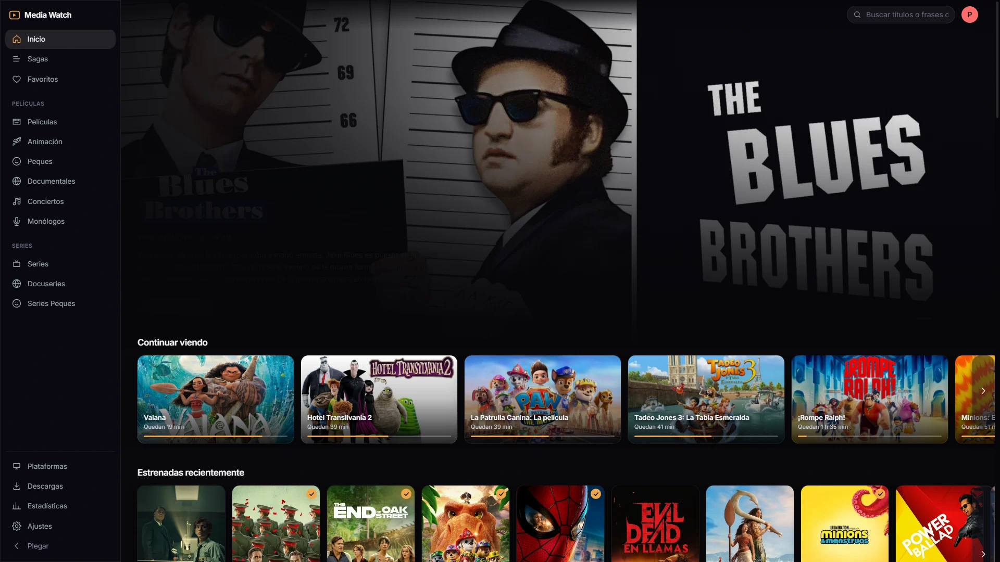 | 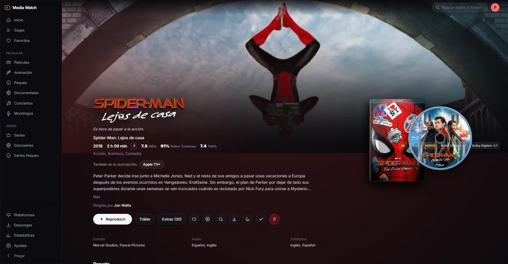 |
| *Banner principal con tráiler ambiente, carrusel de continuar viendo y sagas* | *Badges de pistas, notas Rotten Tomatoes/IMDb, disco 3D y extras nativos 16:9* |

| Catálogo de Pósteres | Estadísticas de Uso |
|:---:|:---:|
| 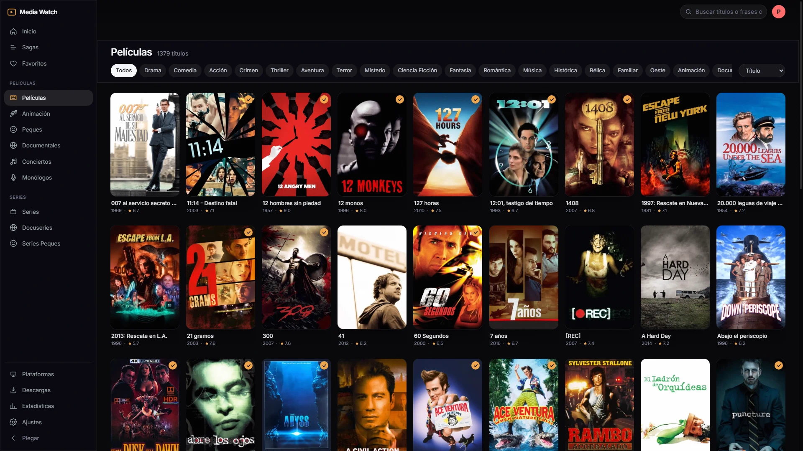 | 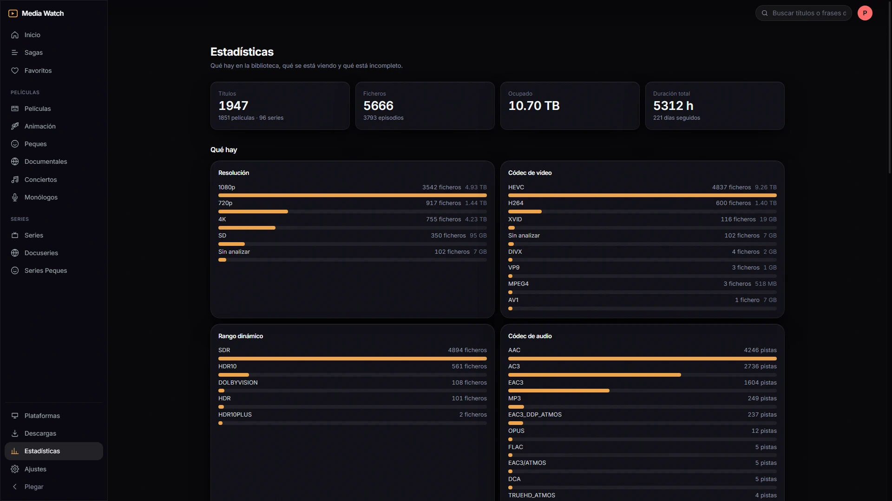 |
| *Búsqueda rápida por metadatos, filtros y cuadrícula fluida* | *Estadísticas de reproducción, actividad por horas y dispositivos* |

---

### Samsung Smart TV (Tizen)

| Pantalla Principal en Gran Formato | Menú Lateral Personalizable |
|:---:|:---:|
| 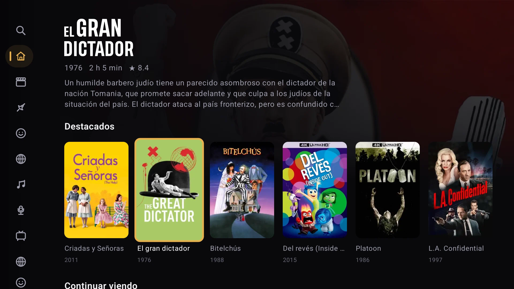 | 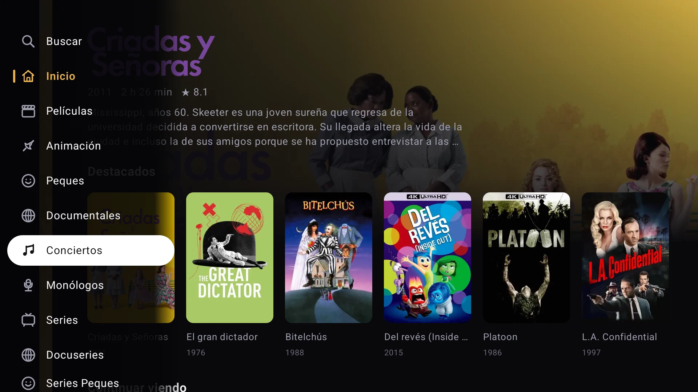 |
| *Navegación espacial a 60 FPS con la cruceta del mando a distancia* | *Reordenación de secciones agarrando y soltando para priorizar tus bibliotecas* |

| Cuadrícula de Biblioteca en TV | HUD de Reproducción Nativo (AVPlay) |
|:---:|:---:|
| 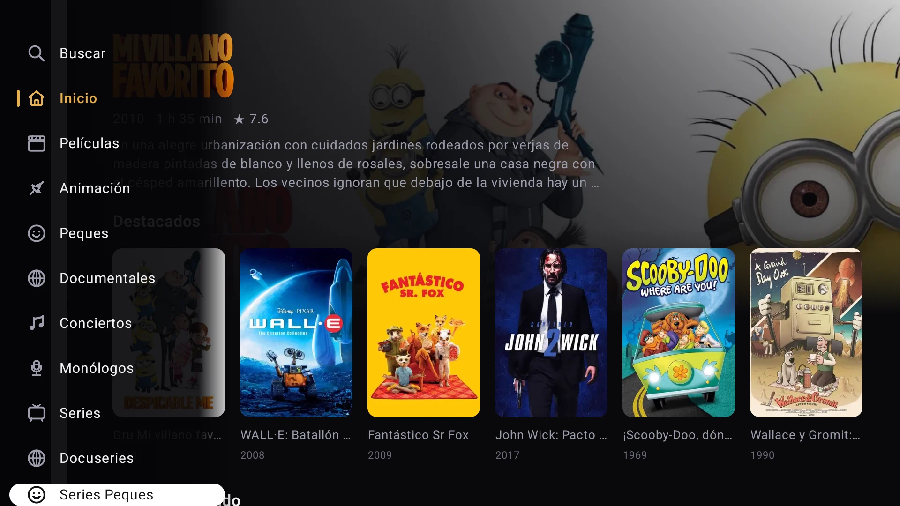 | 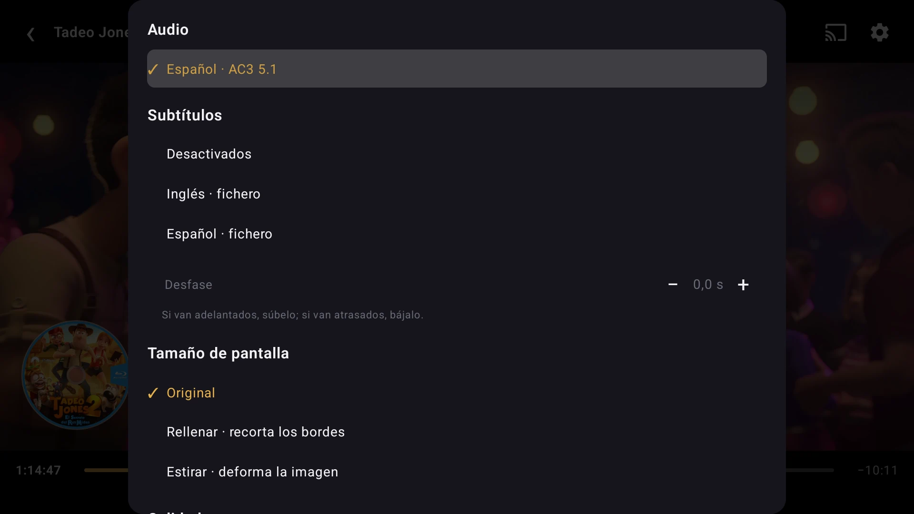 |
| *Navegación fluida por catálogo en la tele* | *Línea de tiempo con miniaturas trickplay, ajuste de desfase de subtítulos y audio* |

---

### Android (Móviles, Tablets y Google Cast)

| Portada Móvil | Ficha y Descargas Locales |
|:---:|:---:|
| 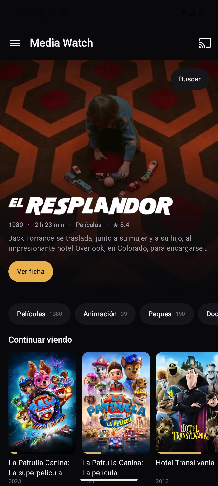 | 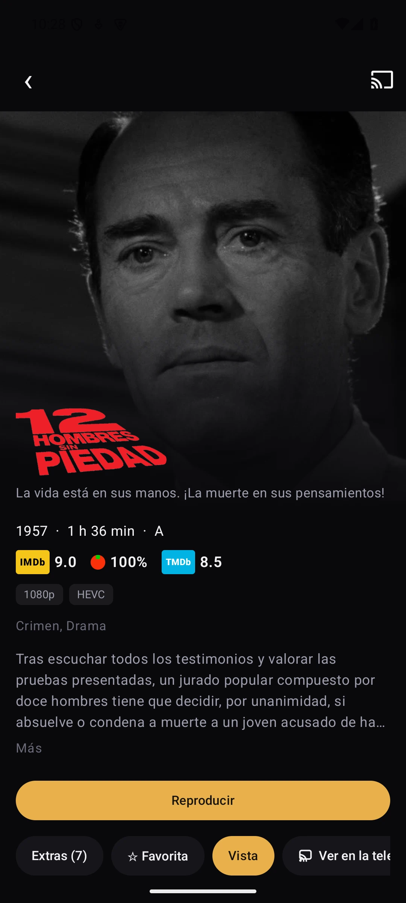 |
| *Interfaz Jetpack Compose con reanudación rápida* | *Perfiles de descarga, selector de pistas de audio y visor de tráilers* |

| Menú Desplegable Reordenable | Ajustes de la Aplicación |
|:---:|:---:|
| 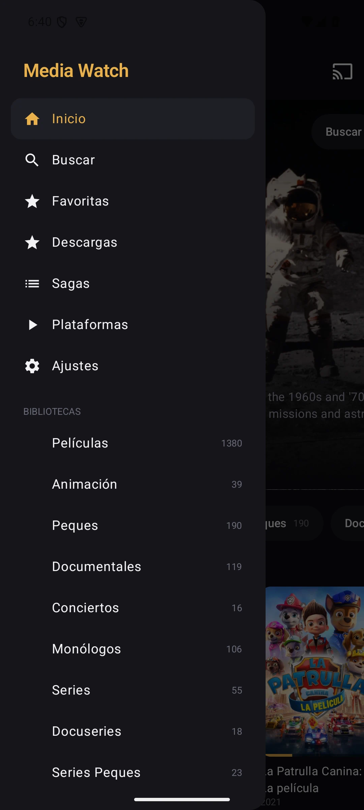 | 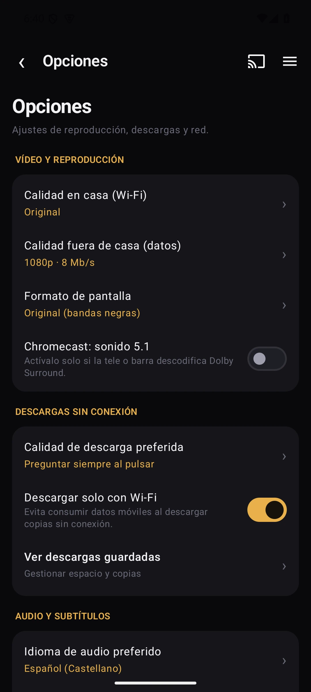 |
| *Organización de secciones arrastrando y soltando* | *Ajuste de bitrate máximo, modos de sonido e idioma de la app* |

---

### Cliente de Escritorio (Windows, macOS y Linux — Electron + mpv)

Reproductor de escritorio dedicado, desarrollado para Direct Play bit a bit, decodificación por hardware en GPU y sonido de cine sin pérdidas, sin transcodificar nada en el servidor:

- **Direct Play 100% en crudo**: Reproduce 4K HEVC Main 10, AV1, VP9, VC-1, DTS, DTS-HD MA, Dolby TrueHD, Dolby Atmos, FLAC y subtítulos gráficos (PGS, ASS/SSA) de forma nativa mediante mpv integrado (`raw=1`).
- **Aceleración por GPU dedicada**: Aprovecha la decodificación por hardware (Intel Arc QSV, NVIDIA NVDEC, AMD D3D11VA, Apple Silicon VideoToolbox y VA-API en Linux) con 0% de uso de CPU.
- **Motor moderno libplacebo (`gpu-next`)**: Cadena swapchain nativa BT.2020 PQ para HDR en Windows 11, Apple Liquid Retina XDR / EDR en macOS y mapeo de tonos spline de alta precisión en pantallas SDR.
- **Modos de sonido audiófilo**: PCM estándar, Audio Raw / Exclusivo (WASAPI y CoreAudio bit-perfect) y Passthrough HDMI (Bitstreaming a receptores AV o barras de sonido).
- **Integración con el sistema**: Teclas multimedia globales del teclado, HUD transparente sin marco sobre el vídeo (Windows/Linux) o ventana nativa Metal (macOS), miniaturas trickplay y encadenado automático de episodios.

---

## Requisitos de Hardware

Uno de los pilares del diseño ha sido la ligereza: exprimir el hardware sin necesidad de montar un servidor costoso.

### 1. Modo Direct Play (Reproducción directa en red local)
Si tu tele, móvil o PC soporta el formato nativo del vídeo (MKV o MP4 con H.264, HEVC, AV1, AAC, AC3, EAC3, TrueHD...):
- **CPU**: Cualquier procesador x86-64 de 64 bits (Intel Celeron J4125/N5105, Intel N100, o cualquier Core i3/i5 de sobremesa antiguo).
- **RAM**: **2 GB mínimo** (el proceso del servidor Node.js / Fastify consume apenas entre 120 y 200 MB de memoria).
- **Almacenamiento**: ~300 MB para el ejecutable + 2 a 4 GB para carátulas locales, miniaturas y la base de datos SQLite.
- **Red**: Cable Ethernet Gigabit o Wi-Fi de 5 GHz recomendado para remuxes 4K de alto bitrate (50–90 Mbps).

### 2. Transcodificación en tiempo real por Hardware (GPU)
Cuando hace falta convertir el vídeo al vuelo (subtítulos incrustados, menor bitrate fuera de casa o codecs incompatibles):
- **Intel (Recomendado / mayor eficiencia y calidad)**:
  - Cualquier procesador Intel con gráfica integrada UHD / Iris Xe desde la 7ª generación (Kaby Lake) en adelante mediante **Intel Quick Sync Video (QSV)**.
  - Para decodificación y transcodificación AV1 por hardware: gráficos Intel Arc (A380, A750, A770 o GPUs móviles Arc como A730M) o procesadores Intel Core Ultra (Meteor Lake / Arrow Lake).
- **NVIDIA**: Soporte para **NVENC / NVDEC** (arquitecturas Turing, Ampere, Ada Lovelace o Blackwell).
- **AMD**: Soporte para **AMF / VA-API** en Linux y Windows.

---

## Arquitectura y Características Principales

- **Base de Datos Ultrarrápida en SQLite**:
  - Utiliza el motor nativo de alto rendimiento `node:sqlite` con modo WAL (*Write-Ahead Logging*).
  - Tiempos de respuesta de la API por debajo de 5 ms para búsquedas instantáneas y filtrado dinámico.
- **Transmisión Adaptativa y Transcodificación de Alto Rendimiento**:
  - *Direct Play*: Envío en crudo del flujo original con 0% de uso de CPU.
  - *Direct Stream / Remux*: Remuxeo al vuelo cambiando el contenedor o convirtiendo únicamente el audio cuando el cliente lo requiere.
  - *Aceleración por GPU*: Transcodificación acelerada por hardware (Intel QSV, NVIDIA NVENC, AMD AMF o software como respaldo).
  - *Trickplay Scrubbing*: Generación rápida de tiras de miniaturas para la barra de progreso.
- **Reproductor Nativo de Escritorio (Windows, macOS y Linux)**:
  - Construido con Electron y un motor nativo `mpv` embebido con reproducción Direct Play (`raw=1`), eliminando cualquier transcodificación en el servidor.
  - Aceleración por hardware dedicada (Intel Arc QSV, NVIDIA NVDEC, AMD D3D11VA, Apple Silicon VideoToolbox y Linux VA-API).
  - Pipeline de renderizado moderno con `libplacebo` (`gpu-next`), HDR nativo y mapeo de tonos spline de alta precisión en pantallas SDR.
  - Opciones de sonido audiófilo: PCM estándar, Audio Raw / Exclusivo (WASAPI y CoreAudio bit-perfect) y Passthrough HDMI (Bitstreaming a receptores AV).
  - Integración completa con el sistema: atajos de teclado multimedia globales, HUD transparente sobre el vídeo, miniaturas de barra y encadenado de episodios.
- **Mi Lista y Progreso Compartido**:
  - Lista de seguimiento unificada por perfil sincronizada entre Web, Smart TV, Android y Escritorio.
  - Autoreproducción inteligente del siguiente episodio con cuenta atrás.
  - Temporizador de apagado (*Sleep Timer*) para ver contenidos en la cama.
  - Logotipos de estudios de producción en alta definición respetando colores corporativos.
- **Extras y Contenido Especial Integrado**:
  - Filas panorámicas 16:9 integradas en la ficha (*Detrás de las cámaras*, *Tomas falsas*, *Escenas eliminadas*, *Entrevistas*).
  - Descarga opcional automatizada de extras y tráileres oficiales mediante TMDb y `yt-dlp`.
  - Tráiler flotante en la portada con fundido suave de audio.
- **Subtítulos Inteligentes y Sincronización Acústica**:
  - Búsqueda en tiempo real de subtítulos en español e inglés en OpenSubtitles y SubSource.
  - Sincronización acústica automática calculando la correlación cruzada contra la pista de diálogo central.
  - Ajuste manual interactivo del desfase de subtítulos con vista previa en directo.
  - Transcripción local mediante IA (Whisper) para archivos sin subtítulos disponibles.
  - OCR al vuelo convirtiendo subtítulos gráficos PGS de Blu-ray a WebVTT para Smart TVs.
- **Modos de Escucha Nocturna y Optimización Acústica**:
  - *Claridad de Diálogos*: Realce de frecuencias vocales en el canal central para entender cada palabra sin subir el volumen general.
  - *Modo Noche*: Compresión de rango dinámico para equilibrar susurros y explosiones estruendosas.
- **Empaquetado Coleccionista Steelbook 3D**:
  - Steelbook 3D interactivo con disco extraíble y visor de carátula en alta definición.
- **Aplicación Dedicada para Samsung Smart TV (Tizen)**:
  - Navegación espacial ortogonal fluida con la cruceta del mando a distancia.
  - Menú lateral reorganizable agarrando y soltando (`[OK]` para coger y soltar).
  - Detección acústica de intros y temas de series mediante huella digital Chromaprint.
- **Interfaz Multilingüe**:
  - Inglés y Español disponibles en Web, Smart TV, Android y Escritorio.

---

## Estructura del Proyecto

| Directorio | Componente | Stack |
|---|---|---|
| `server/` | Servidor API REST y motor de streaming | Node.js + TypeScript (Fastify) + SQLite (`node:sqlite`) |
| `web/` | Cliente Web | React 19 + Vite 6 + Tailwind CSS 4 + Motion |
| `tv/` | Cliente Smart TV (Samsung Tizen) | TypeScript plano + ES2016 IIFE + AVPlay nativo |
| `android/` | App Android (Móviles / Tablets / Cast) | Kotlin + Jetpack Compose + Media3 (ExoPlayer) + Google Cast |
| `desktop/` | Cliente de Escritorio (Windows, macOS y Linux) | Electron 44 + mpv incrustado + decodificación GPU (QSV / D3D11 / VideoToolbox / VA-API) |
| `data/` | Datos locales de ejecución (no en git) | Base de datos SQLite, caché de arte, miniaturas trickplay |

---

## Cómo Arrancar desde el Código Fuente

### 1. Clonar el repositorio
```bash
git clone https://github.com/pacotegg/mediawatch.git
cd mediawatch
```

### 2. Instalar dependencias
```bash
npm install
```

### 3. Configuración inicial
Crea el fichero `data/config.json` con tus carpetas de películas y series:
```json
{
  "port": 8730,
  "libraries": [
    { "name": "Películas", "path": "D:\\Media\\Peliculas", "kind": "movie" },
    { "name": "Series", "path": "D:\\Media\\Series", "kind": "show" }
  ],
  "ffmpeg": "ffmpeg",
  "ffprobe": "ffprobe",
  "python": "python"
}
```

### 4. Escanear la biblioteca
```bash
npm run scan
```

### 5. Iniciar el servidor
```bash
npm start
```
Accede desde tu red local en `http://<ip-de-tu-servidor>:8730` o localmente en `http://localhost:8730`.

---

## Aplicaciones Cliente y Compilación

> 💡 **¿Solo quieres usar las aplicaciones sin compilar código?**  
> ¡No necesitas compilar nada! Si tu objetivo es simplemente disfrutar de tu contenido:
> - **Ordenador (Windows, macOS y Linux)**: Descarga el instalador listo para usar desde **[Releases](https://github.com/pacotegg/mediawatch/releases)** o desde la página `/instalar.html` de tu propio servidor.
> - **Móviles y Tablets (Android)**: Descarga el archivo `.apk` directamente desde `/instalar.html` en el navegador de tu móvil.
> - **iPhone y iPad**: Abre la web en Safari, pulsa el botón *Compartir* (icono ⎋) y elige *«Añadir a pantalla de inicio»*.
> 
> *Sigue las guías siguientes únicamente si quieres desarrollar, modificar o compilar las aplicaciones tú mismo desde el código fuente.*

---

### 1. Cliente de Escritorio (Windows, macOS y Linux)

El cliente de escritorio está construido sobre **Electron** y el motor de vídeo **mpv** embebido para reproducción directa sin transcodificación.

#### A. En Windows 10 / 11
1. Entra en la carpeta del cliente e instala sus dependencias:
   ```bash
   cd desktop
   npm install
   ```
2. Compila el instalador de Windows:
   ```bash
   npm run dist
   ```
   *¿Qué hace este comando?* Descarga automáticamente una compilación de `mpv` verificada por SHA-256, compila el código TypeScript y empaqueta el instalador `.exe` (NSIS) en la carpeta `desktop/release/MediaWatch-Escritorio-Setup-<versión>.exe`. Solo tienes que ejecutarlo como cualquier programa de Windows.

#### B. En macOS (Apple Silicon M1–M4 e Intel)
1. Instala el motor `mpv` en tu Mac si aún no lo tienes (usando [Homebrew](https://brew.sh/)):
   ```bash
   brew install mpv
   ```
2. Entra en la carpeta y compila el paquete universal de Mac:
   ```bash
   cd desktop
   npm install
   npm run dist:mac
   ```
   *Resultado*: Genera el archivo `MediaWatch-Escritorio-<versión>-mac.dmg` en `desktop/release/`. Ábrelo y arrastra la app a tu carpeta de *Aplicaciones*.
   > ℹ️ **Nota para macOS (Gatekeeper)**: La primera vez que abras la app, haz **Control + Clic** (clic derecho) sobre ella y selecciona **Abrir** para confirmar la excepción de seguridad de Apple (o ejecuta en Terminal `xattr -cr /Applications/Media\ Watch.app`).

#### C. En Linux (Ubuntu, Debian, Fedora, Arch, etc.)
1. Asegúrate de tener `mpv` instalado en tu distribución:
   ```bash
   sudo apt install mpv    # En Debian/Ubuntu/Mint
   sudo dnf install mpv    # En Fedora
   sudo pacman -S mpv      # En Arch
   ```
2. Compila los paquetes de Linux:
   ```bash
   cd desktop
   npm install
   npm run dist:linux
   ```
   *Resultado*: En `desktop/release/` obtendrás tanto el paquete portable universal `.AppImage` como el instalador `.deb`. Para lanzar el AppImage:
   ```bash
   chmod +x desktop/release/MediaWatch-Escritorio-*.AppImage
   ./desktop/release/MediaWatch-Escritorio-*.AppImage
   ```

---

### 2. Cliente Web y Entorno de Desarrollo

- **Compilar para producción**:
  ```bash
  npm run build
  ```
  Genera los archivos estáticos optimizados en `web/dist/`, que el servidor Fastify sirve automáticamente sin necesidad de configurar ningún servidor web adicional.
- **Modo desarrollo (Hot Reload)**:
  ```bash
  npm run dev
  ```
  Inicia el servidor backend y el servidor de desarrollo Vite con recarga en caliente instantánea al modificar cualquier componente de React.

---

### 3. Samsung Smart TV (Tizen 5.0+ / Modelos 2019 en adelante)

No necesitas instalar los más de 5 GB de Tizen Studio en tu ordenador: empaquetamos e instalamos la aplicación directamente en la tele a través de Docker.

#### Paso 1: Activar el Modo Desarrollador en tu televisor
1. En el mando a distancia, pulsa el botón **Home** y entra en la sección **Apps**.
2. Con el teclado numérico del mando (o el menú numérico en pantalla), pulsa sucesivamente: `1`, `2`, `3`, `4`, `5`.
3. Se abrirá una ventana oculta titulada **Developer Mode**.
4. Marca la opción en **ON** e introduce en el campo **Host PC IP** la dirección IP local de tu ordenador (por ejemplo `192.168.1.50`).
5. Pulsa *OK* y **reinicia la tele** manteniendo pulsado el botón de encendido del mando durante 3 segundos hasta que vuelva a salir el logotipo de Samsung.

#### Paso 2: Compilar e instalar la app
1. Compila el cliente de televisión desde la raíz del proyecto:
   ```bash
   npm run build --workspace tv
   ```
2. Ejecuta el contenedor de Docker para empaquetar e instalar en la tele (sustituyendo `<IP_DE_TU_TELE>` por la IP de tu televisor Samsung en la red local):
   ```bash
   MSYS_NO_PATHCONV=1 docker run --rm --network host -v "${PWD}/tv:/app" \
     --entrypoint sh ghcr.io/georift/install-jellyfin-tizen:latest -c '
   export PATH=$PATH:/tizen-studio/tools:/tizen-studio/tools/ide/bin
   sdb connect <IP_DE_TU_TELE>:26101
   TELE=$(sdb devices | grep -v "List of" | awk "{print \$3}" | head -1)
   mkdir -p /build && cp -r /app/dist/* /build/ && cd /build
   tizen build-web -- /build >/dev/null 2>&1
   tizen package -t wgt -s dev -- /build/.buildResult
   mv "/build/.buildResult/Media Watch.wgt" "/build/.buildResult/MediaWatch.wgt" 2>/dev/null || true
   tizen install -n MediaWatch.wgt -t "$TELE" -- /build/.buildResult
   '
   ```
   La aplicación **Media Watch** aparecerá instalada en el menú principal de tu televisión.

---

### 4. Aplicación Android (Móviles, Tablets y Google Cast)

#### Requisitos previos
- **JDK 17** instalado y configurado en tu variable de entorno `JAVA_HOME` (por ejemplo [Eclipse Adoptium Temurin 17](https://adoptium.net/temurin/releases/?version=17) o Android Studio).

#### Compilación
1. Entra en el directorio de Android:
   ```bash
   cd android
   ```
2. Compila el paquete release:
   - En **Linux / macOS**:
     ```bash
     ./gradlew :app:assembleRelease
     ```
   - En **Windows**:
     ```powershell
     .\gradlew.bat :app:assembleRelease
     ```
3. El archivo `.apk` final se generará en:
   ```text
   android/app/build/outputs/apk/release/app-release.apk
   ```
4. Para instalarlo en tu móvil conectado por USB con depuración activada:
   ```bash
   adb install -r app-release.apk
   ```
   O cópialo directamente al almacenamiento de tu teléfono y ábrelo desde cualquier explorador de archivos.

---

## Apoya el proyecto

Si disfrutas de Media Watch y quieres echarme una mano con el desarrollo continuo, puedes [invitarme a un café en Ko-fi](https://ko-fi.com/pacotegg). ¡Cualquier aportación se agradece un montón!

---

## Licencia

Media Watch está publicado bajo la licencia **GNU General Public License v3.0**. Consulta el fichero [LICENSE](LICENSE) para más detalles.
