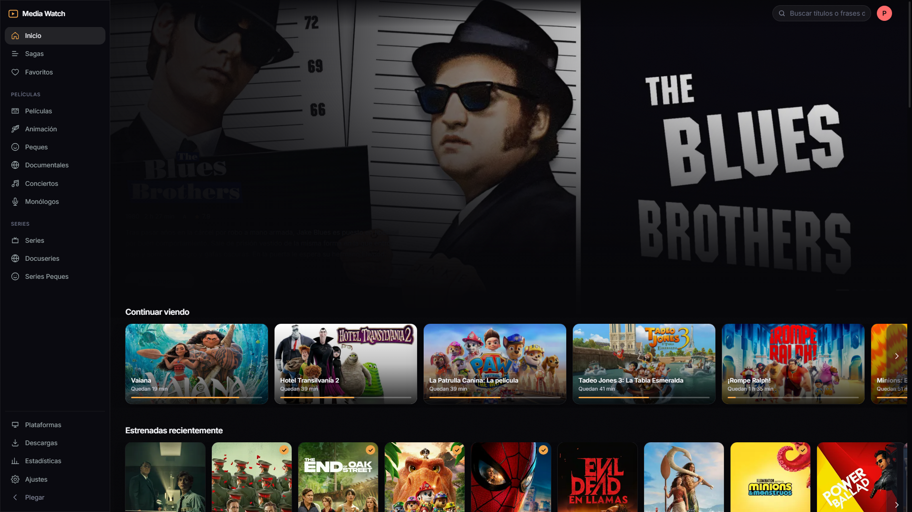
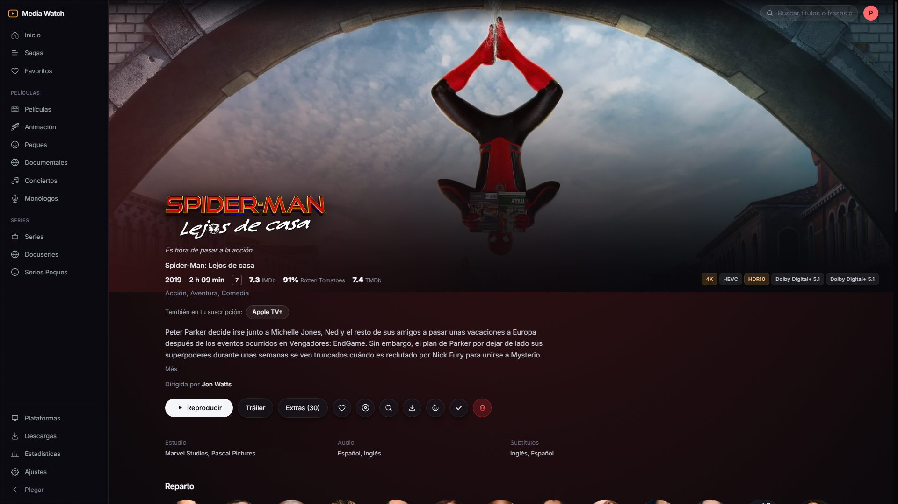
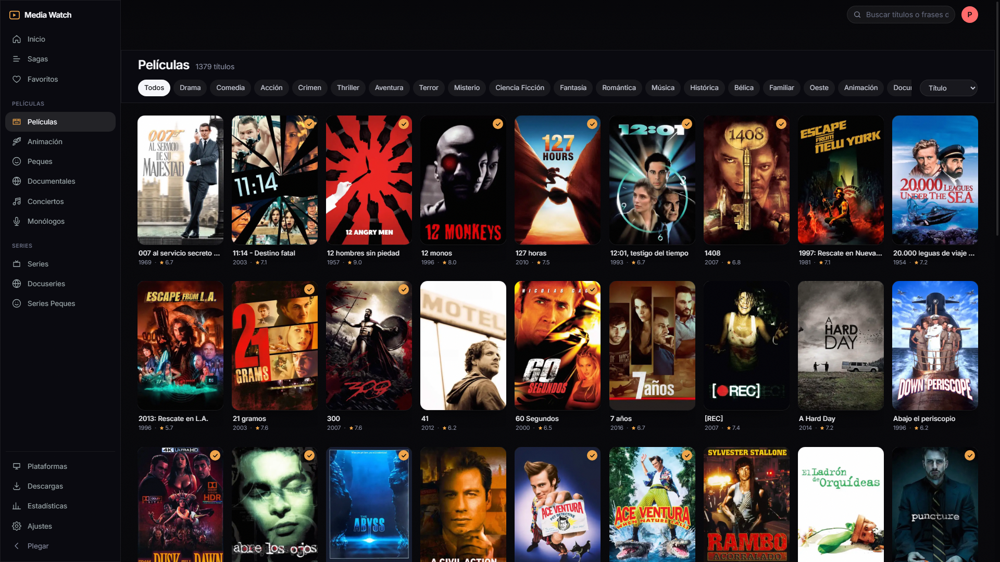
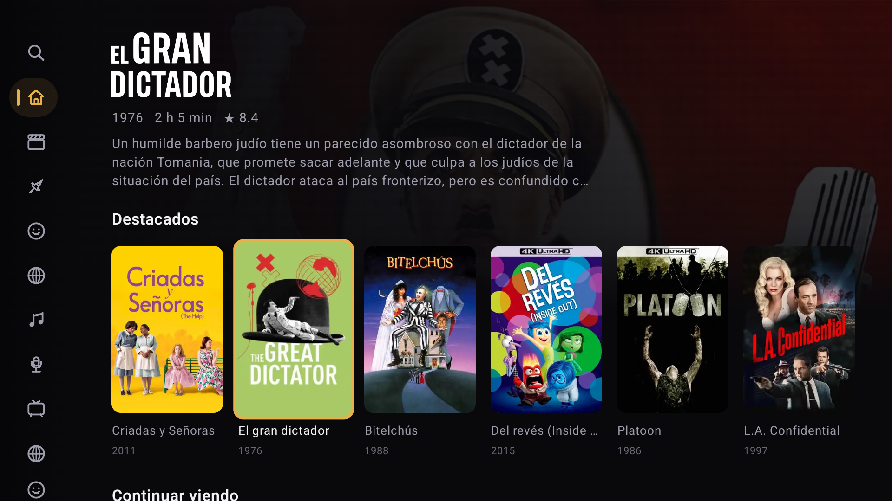
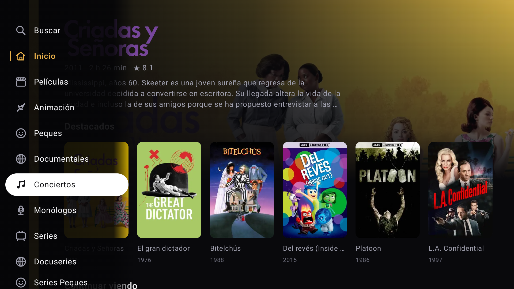
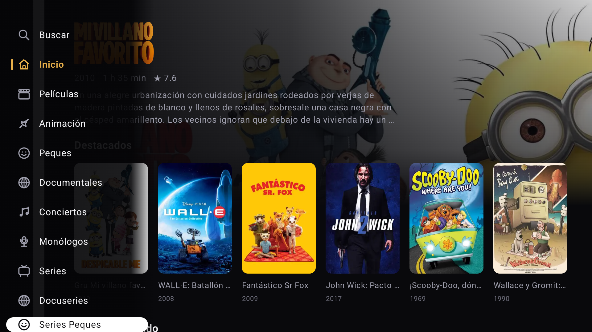
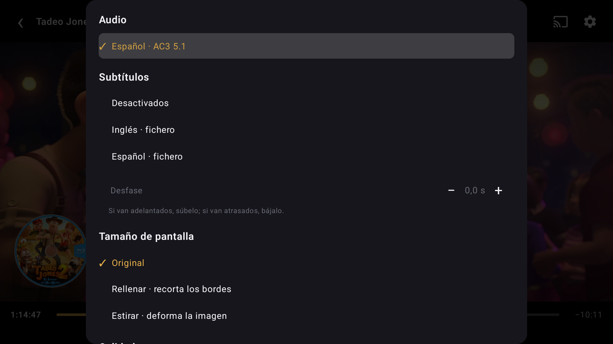
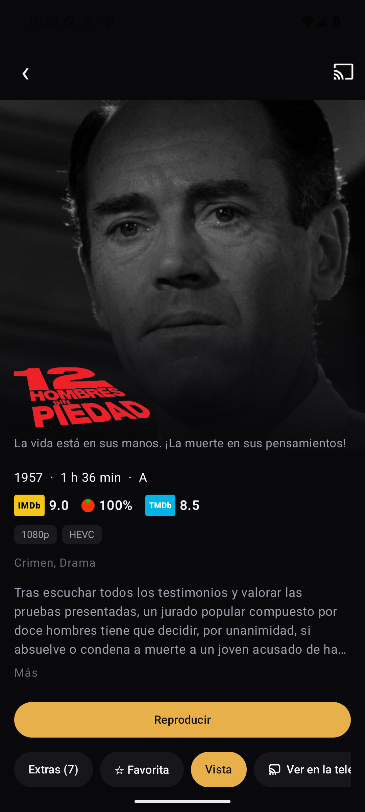
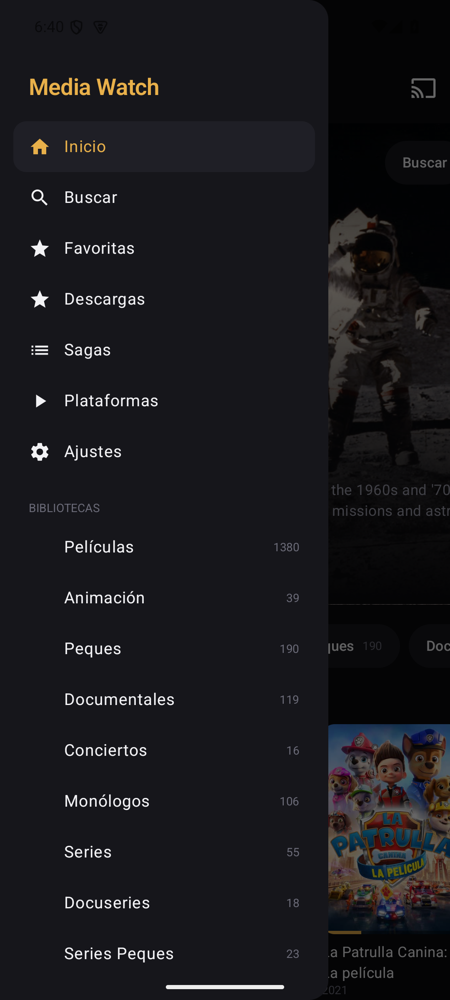
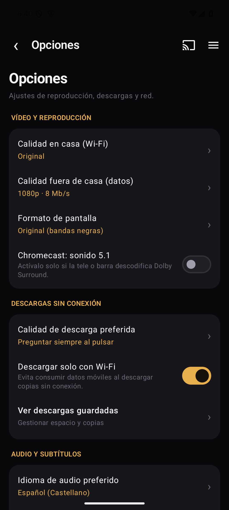

# Media Watch

[](LICENSE)
[](https://nodejs.org/)
[](#client-applications)

A self-hosted personal movie and TV series streaming server inspired by Plex, Jellyfin, and Infuse, built from the ground up without cloud telemetry, subscription paywalls, or third-party cloud lock-in. Designed to run on your local PC, mini-PC, or home server.

Media Watch scans and serves your cataloged media libraries directly from the storage drives and folders where your files reside (e.g. structured via tinyMediaManager with local `.nfo` metadata and artwork). It streams video seamlessly across your local network and transcode/remuxes on the fly only when the client device cannot direct-play the source stream natively.

---

## GNU General Public License v3.0

Media Watch is free and open-source software: you can redistribute it and/or modify it under the terms of the **GNU General Public License version 3.0 (GPLv3)** as published by the Free Software Foundation.

See the [LICENSE](LICENSE) file for full terms and conditions.

---

## Visual Showcase

### Web Client

| Interactive Home & Hero Banner | Media Details & 3D Steelbook |
|:---:|:---:|
|  |  |
| *Hero banner with trailer playback, resume carousel & collections* | *Stream badges, Rotten Tomatoes/IMDb ratings, 3D discart & native 16:9 extras* |

| Poster Grid Library Browsing | Playback Analytics & Statistics |
|:---:|:---:|
|  |  |
| *Fast metadata search, filtering, and responsive poster grid* | *Server-wide playback statistics, hourly activity, and device tracking* |

---

### Samsung Smart TV (Tizen)

| Big-Screen TV Interface | Customizable Sidebar Menu |
|:---:|:---:|
|  |  |
| *Designed for fluid 60 FPS spatial navigation with remote control D-pad* | *Grab & Drop menu reordering to prioritize your favorite libraries* |

| TV Library Grid | AVPlay Native Player HUD |
|:---:|:---:|
|  |  |
| *Responsive large-format TV catalog navigation* | *Trickplay thumbnail scrubbing, subtitle offset HUD & acoustic modes* |

---

### Android Mobile, Tablet & Google Cast

| Mobile Feed | Rich Media Details & Offline Downloads |
|:---:|:---:|
|  |  |
| *Jetpack Compose modern home feed with quick resume cards* | *Direct download profiles, audio track switcher, and trailer viewer* |

| Grab & Drop Navigation Drawer | Detailed Application Settings |
|:---:|:---:|
|  |  |
| *Interactive drag-and-drop section organization* | *Bitrate quality control, audio modes, and interface language selector* |

---

## Key Features

- **100% Zero-Cloud Local Cataloging**:
  - Blazing-fast scanner indexing thousands of titles in seconds directly from local `.nfo` files, posters, fanarts, and backdrops.
  - Automatic film collections and chronological sagas built locally without third-party network calls.
  - Optional on-demand enrichment via TMDb/OMDb when requested (no unwanted automatic metadata overwrites).
- **Adaptive Streaming & High-Performance Transcoding**:
  - *Direct Play*: Native stream passthrough with zero CPU utilization.
  - *Direct Stream / Remux*: Video stream copy with on-the-fly audio transcoding when device codecs require it.
  - *Hardware Acceleration*: GPU-accelerated transcoding via Intel Quick Sync (QSV), NVIDIA NVENC, or VAAPI.
  - *Trickplay Scrubbing*: Keyframe thumbnail strips generated rapidly for timeline scrubbing.
- **Native Extra Featurettes & Behind-The-Scenes**:
  - Dedicated 16:9 extra rows integrated directly into media detail pages (*Behind the Scenes*, *Featurettes*, *Deleted Scenes*, *Interviews*, *Bloopers*, *Short Films*).
  - Optional automated downloading of official extras and trailers via TMDb and `yt-dlp`.
  - Floating ambient trailer preview on the Hero banner with smooth sound fade.
- **Intelligent Subtitles & Acoustic Synchronization**:
  - Real-time multilingual subtitle lookup (English & Spanish) querying OpenSubtitles and SubSource.
  - Automatic acoustic synchronization using cross-correlation against the center audio channel.
  - Floating in-player HUD for live subtitle delay and offset adjustment.
  - Local AI transcription via Whisper for media files lacking subtitles.
  - On-the-fly OCR converting bitmap PGS subtitles to WebVTT on Smart TVs.
- **Acoustic Optimization & Night Listening Modes**:
  - *Dialogue Clarity*: Intelligent acoustic enhancement boosting the center vocal frequency range.
  - *Night Mode*: Dynamic range compression leveling whispers and softening loud explosions.
- **3D Collector's Edition Packaging**:
  - Interactive 3D Steelbook view with extractable physical disc (discart) and high-definition fullscreen viewer.
- **Dedicated Samsung Smart TV (Tizen) App**:
  - Precision orthogonal D-pad spatial navigation.
  - Interactive "Grab & Drop" sidebar customizer (`[OK]` to pick up, move, and drop).
  - Automated TV intro/theme detection via Chromaprint acoustic fingerprints and automated credits detection.
- **Multi-Language Interface Support**:
  - English is enabled by default on all fresh installations and clones.
  - Seamlessly toggle between **English** and **Spanish** in any client (Web, Smart TV, and Android).

---

## Project Structure

| Directory | Component | Stack |
|---|---|---|
| `server/` | REST API Server & Streaming Engine | Node.js + TypeScript (Fastify) + SQLite (`node:sqlite`) |
| `web/` | Web Client | React 19 + Vite 6 + Tailwind CSS 4 + Motion |
| `tv/` | Smart TV Client (Samsung Tizen) | Plain TypeScript + ES2016 IIFE + AVPlay native |
| `android/` | Android Mobile / Tablet / Cast | Kotlin + Jetpack Compose + Media3 (ExoPlayer) + Google Cast |
| `data/` | Local runtime data (git-ignored) | SQLite database, generated artwork cache, trickplay thumbnails |

---

## Prerequisites

1. **Node.js**: Version 22 or higher (Node 26 executes TypeScript directly without a build step).
2. **FFmpeg & FFprobe**: Configured with support for common codecs (H.264, HEVC) and GPU acceleration (Intel QSV, VAAPI, or NVIDIA NVENC).
3. **Python 3.10+**: Used for subtitle acoustic synchronization utilities (`subtitles_api.py`, `subsfetch.py`).
4. **yt-dlp**: Optional, used for fetching official extra featurettes to disk.

---

## Installation & Getting Started

### 1. Clone the repository
```bash
git clone https://github.com/pacotegg/mediawatch.git
cd mediawatch
```

### 2. Install dependencies
```bash
npm install
```

### 3. Initial Configuration
Create `data/config.json` defining your server port and the directories or drives hosting your media libraries:
```json
{
  "port": 8730,
  "libraries": [
    { "name": "Movies", "path": "D:\\Media\\Movies", "kind": "movie" },
    { "name": "TV Shows", "path": "D:\\Media\\TVShows", "kind": "show" }
  ],
  "ffmpeg": "ffmpeg",
  "ffprobe": "ffprobe",
  "python": "python"
}
```
> **Note**: `ffmpeg` and `ffprobe` can point to system `PATH` executables or exact absolute file paths on your machine.

### 4. Scan your media library
Scan and index local `.nfo` metadata and artwork:
```bash
npm run scan
```

### 5. Launch the server
```bash
npm start
```
The server will be reachable at:
- Local machine: `http://localhost:8730`
- Local network: `http://<your-server-ip>:8730`

For frontend live-reload development (server + web):
```bash
npm run dev
```

---

## Interface Language Configuration

Media Watch supports multiple interface languages (English and Spanish):
- **Default for new installations**: English (`en`).
- **Web**: Switch language anytime by clicking your profile avatar in the upper right or in **Settings** → **Playback** → **Interface language**.
- **Samsung Smart TV**: Go to **Settings** → **Language** (`English` / `Español`).
- **Android**: Open the drawer menu, go to **Settings** → **Experience & Presentation** → **Interface language**.

---

## Client Applications & Building

### Web & Smart TV
```bash
npm run build
```
Builds static bundles to `web/dist/` (served directly by the backend) and `tv/dist/`.

### Samsung Smart TV (Tizen)
Package and install the `.wgt` application to your Samsung TV using the official Docker container:
```bash
MSYS_NO_PATHCONV=1 docker run --rm --network host -v "${PWD}/tv:/app" \
  --entrypoint sh ghcr.io/georift/install-jellyfin-tizen:latest -c '
export PATH=$PATH:/tizen-studio/tools:/tizen-studio/tools/ide/bin
sdb connect <TV_IP>:26101
TELE=$(sdb devices | grep -v "List of" | awk "{print \$3}" | head -1)
mkdir -p /build && cp -r /app/dist/* /build/ && cd /build
tizen build-web -- /build >/dev/null 2>&1
tizen package -t wgt -s dev -- /build/.buildResult
mv "/build/.buildResult/Media Watch.wgt" "/build/.buildResult/MediaWatch.wgt" 2>/dev/null || true
tizen install -n MediaWatch.wgt -t "$TELE" -- /build/.buildResult
'
```

### Android App
```bash
cd android
./gradlew :app:assembleRelease
```
The compiled APK will be generated at `android/app/build/outputs/apk/release/`.

---

## Controls & Keybindings

### Web Player Shortcuts

| Key | Action |
|---|---|
| `Space` / `K` | Play / Pause |
| `←` / `→` | Short seek (10–15 s configurable) |
| `Shift` + `←` / `→` | Long seek (60 s) |
| `↑` / `↓` | Volume control |
| `F` | Toggle fullscreen |
| `M` | Mute / Unmute audio |
| `G` / `H` | Adjust subtitle delay (-50 ms / +50 ms) |
| `C` | Toggle subtitles |
| `Esc` | Exit player |
| `/` | Focus search bar (when outside player) |

### Smart TV Remote Control (Tizen)

- **D-Pad (`▲ / ▼ / ◄ / ►`)**: Fluid orthogonal spatial navigation across media cards and carousels.
- **`[ENTER / OK]`**: Select title, play, or pause.
- **Grab & Drop Menu Reordering**: In Settings → *Customize menu*, press `[OK]` to grab any section (highlighted in bright amber), move it up or down using `[▲ / ▼]`, and press `[OK]` again to release. Press `[►]` to toggle visibility.
- **`[BACK]`**: Return to previous screen or dismiss menus.

---

## License

Media Watch is licensed under the **GNU General Public License v3.0**. See the [LICENSE](LICENSE) file for complete details.
