# Media Watch

[](LICENSE)
[](https://nodejs.org/)
[](#client-applications--building)
[-0078D6.svg?logo=windows&logoColor=white)](https://github.com/pacotegg/mediawatch/releases)
[](https://github.com/pacotegg/mediawatch/releases)
[](https://ko-fi.com/pacotegg)

[English](README.md) · [Español](README.es.md)

> ☕ **Enjoying Media Watch?** If you'd like to support ongoing development, you can [buy me a coffee on Ko-fi](https://ko-fi.com/pacotegg) or use the **Sponsor** button above!

I built Media Watch for my living room HTPC setup because I wanted a clean, fast streaming server that feels like a premium home cinema experience — without telemetry, cloud user accounts, or subscription paywalls.

It reads your media library directly from your storage drives, indexes your metadata and artwork, and streams to your TV, phone, tablet, or browser. If your player supports the file, it Direct Plays untouched with virtually 0% CPU. If you need transcoding (subtitles, lower bitrates outside home, or unsupported codecs), it uses your GPU hardware acceleration.

> 💡 **Looking for ready-to-run client and server installers?**  
> - 💻 **Desktop Client (Windows, macOS & Linux)**: Download the dedicated player with GPU Direct Play, HDR and HDMI audio passthrough: **[Windows Setup (.exe)](https://github.com/pacotegg/mediawatch/releases/tag/escritorio-v0.6.1)** · **[macOS Installer (.dmg)](https://github.com/pacotegg/mediawatch/releases/tag/escritorio-v0.6.1)** · **[Linux AppImage & .deb](https://github.com/pacotegg/mediawatch/releases/tag/escritorio-v0.6.1)**  
> - 📱 **Mobile & Cast**: Get the Android app APK from **[Releases](https://github.com/pacotegg/mediawatch/releases)** or your local server's `/instalar.html` page.  
> - 🖥️ **Standalone Desktop Server**: Check out **[MediaWatch Server](https://github.com/pacotegg/MediaWatch-Server)** for an all-in-one desktop server package with tray icon, automatic TMDb scraping without `.nfo` files, and instant QR pairing. This repository (`pacotegg/mediawatch`) is the core engine.

---

## GNU General Public License v3.0

Media Watch is free and open-source software: you can redistribute it and/or modify it under the terms of the **GNU General Public License version 3.0 (GPLv3)** as published by the Free Software Foundation. See [LICENSE](LICENSE) for details.

---

## Visual Showcase

### Web Client (React 19 + Tailwind CSS)

| Interactive Home & Hero Banner | Media Details & 3D Steelbook |
|:---:|:---:|
| 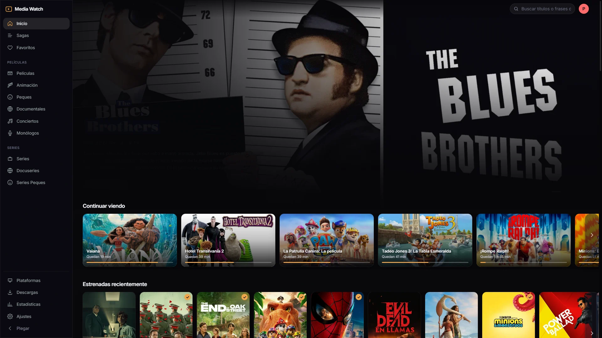 | 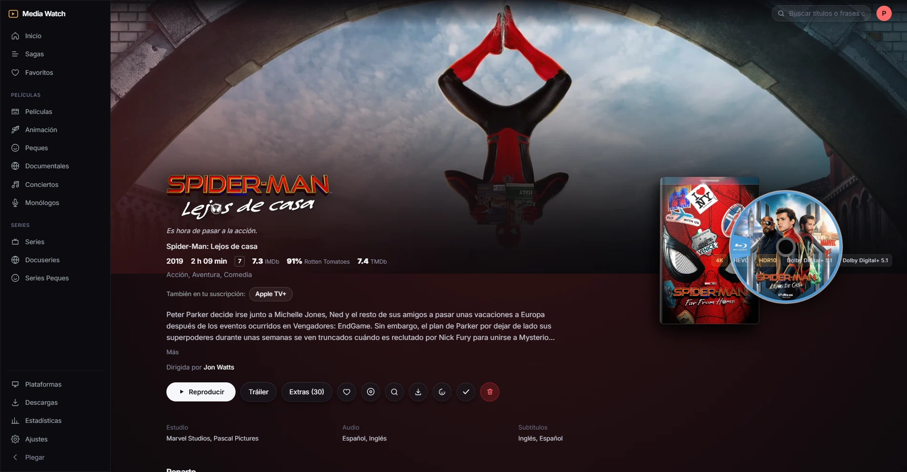 |
| *Hero banner with trailer playback, resume carousel & collections* | *Stream badges, Rotten Tomatoes/IMDb ratings, 3D discart & native 16:9 extras* |

| Poster Grid Library Browsing | Playback Analytics & Statistics |
|:---:|:---:|
| 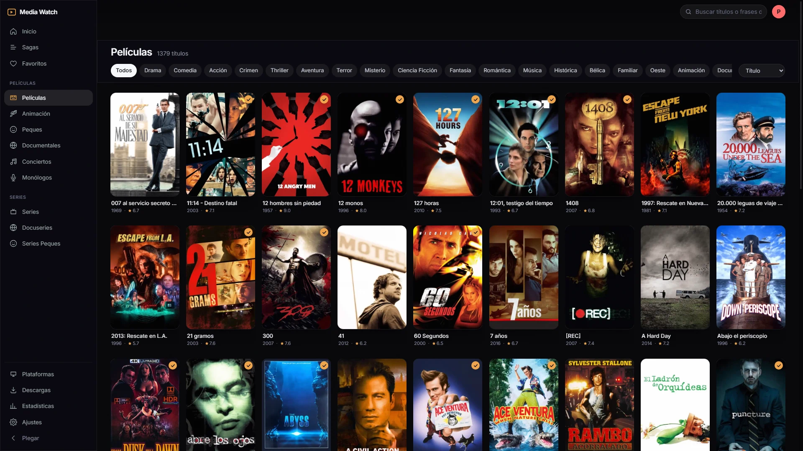 | 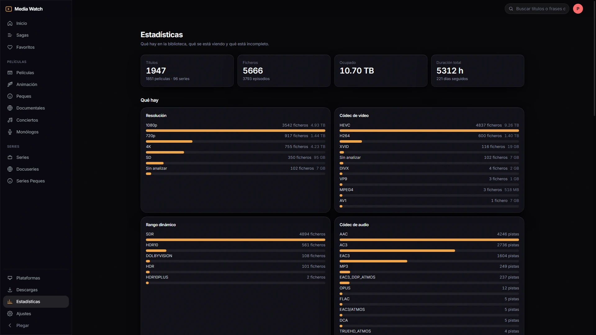 |
| *Instant metadata search, filtering, and responsive poster grid* | *Playback statistics, hourly activity, and device tracking* |

---

### Samsung Smart TV (Tizen)

| Big-Screen TV Interface | Customizable Sidebar Menu |
|:---:|:---:|
| 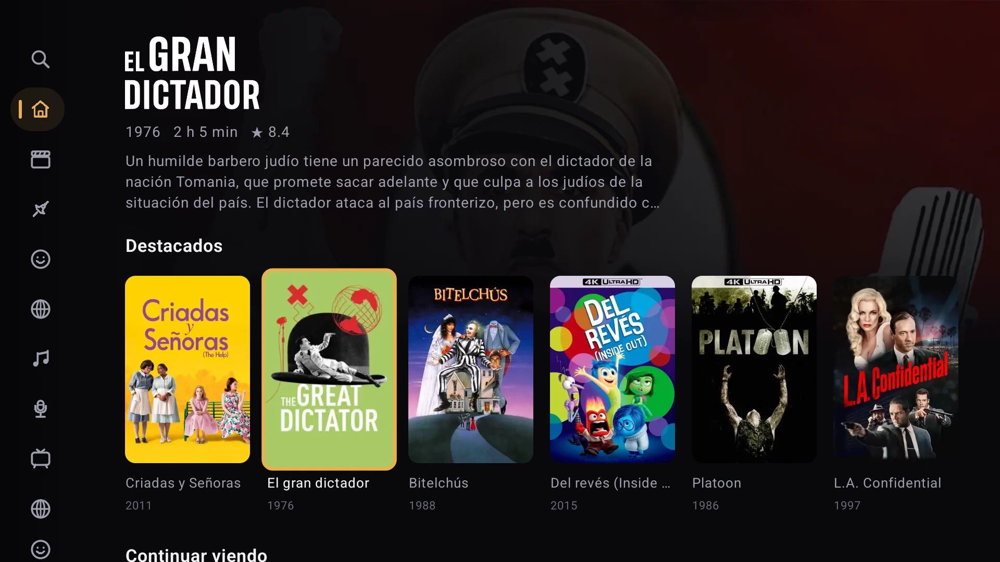 | 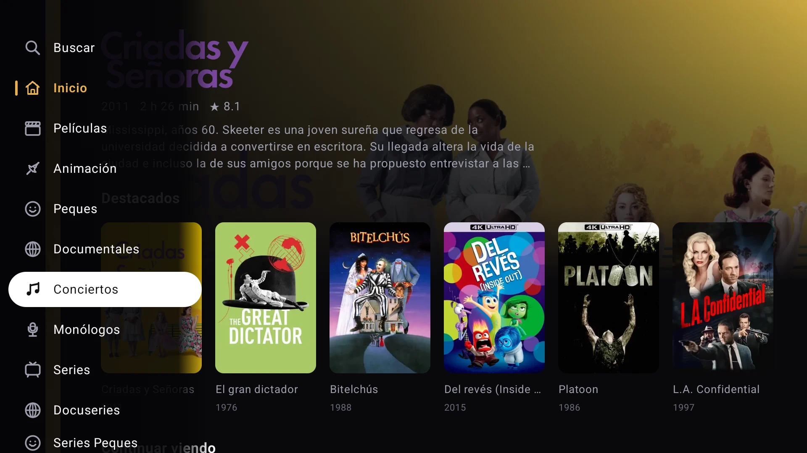 |
| *Designed for fluid 60 FPS spatial navigation with remote control D-pad* | *Grab & Drop menu reordering to prioritize your favorite libraries* |

| TV Library Grid | AVPlay Native Player HUD |
|:---:|:---:|
| 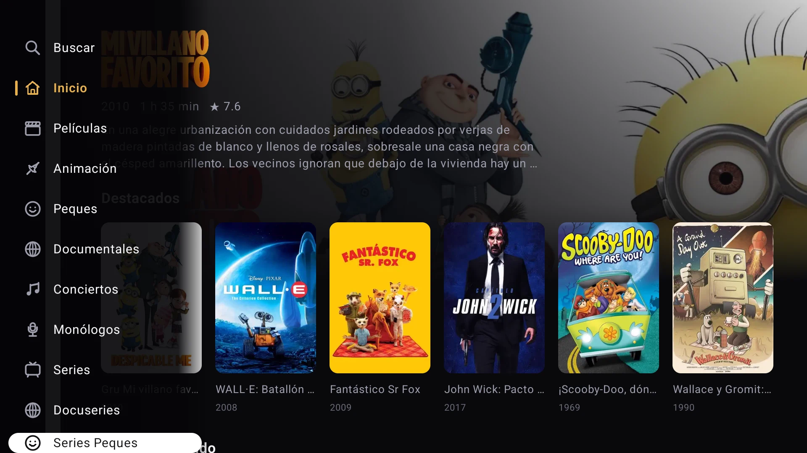 | 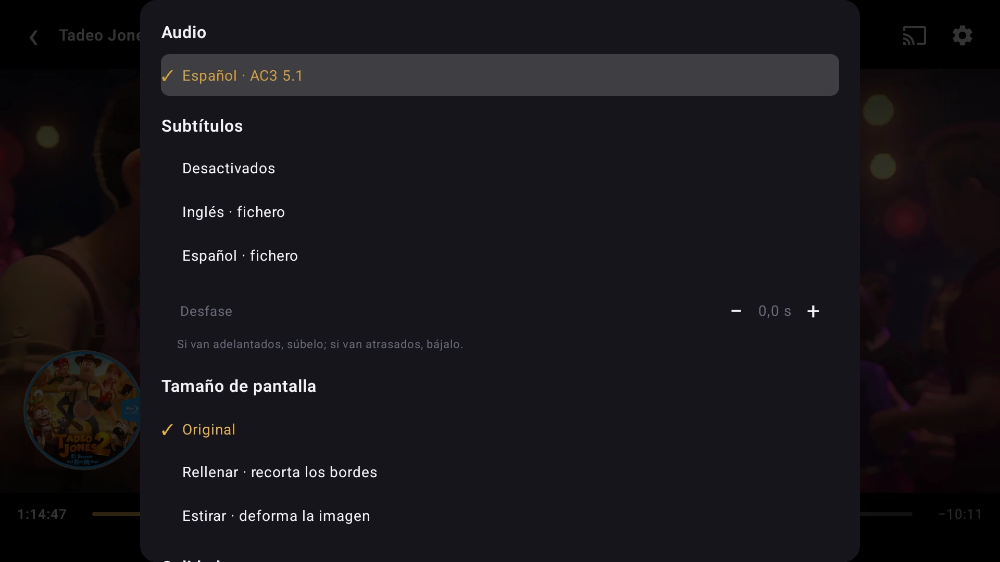 |
| *Large-format TV catalog navigation* | *Trickplay thumbnail scrubbing, subtitle offset HUD & acoustic modes* |

---

### Android Mobile, Tablet & Google Cast

| Mobile Feed | Rich Media Details & Offline Downloads |
|:---:|:---:|
| 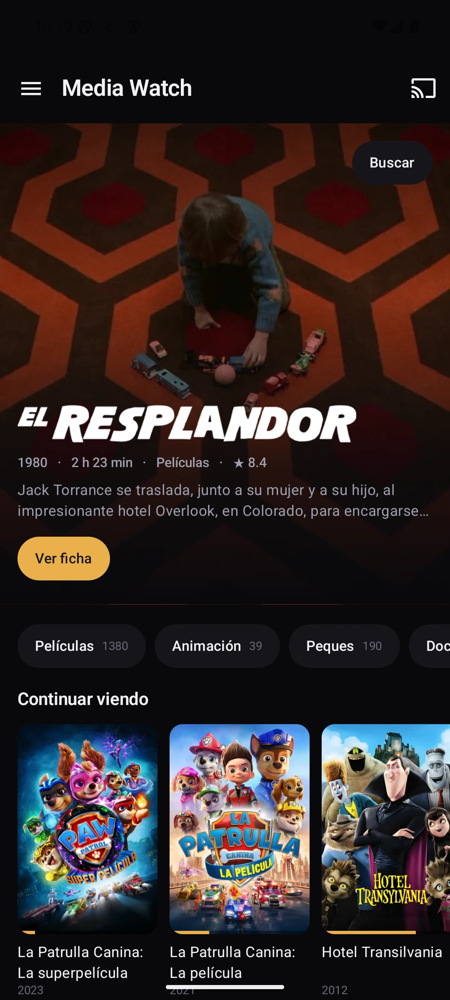 | 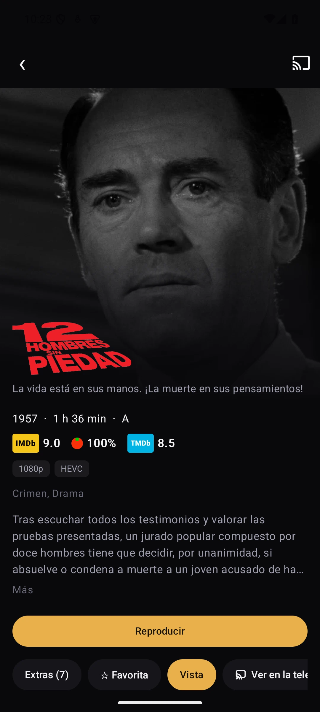 |
| *Jetpack Compose feed with quick resume cards* | *Direct download profiles, audio track switcher, and trailer viewer* |

| Grab & Drop Navigation Drawer | Detailed Application Settings |
|:---:|:---:|
| 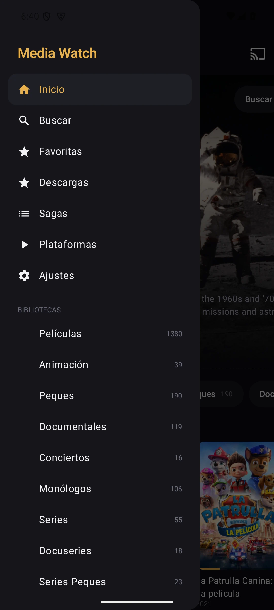 | 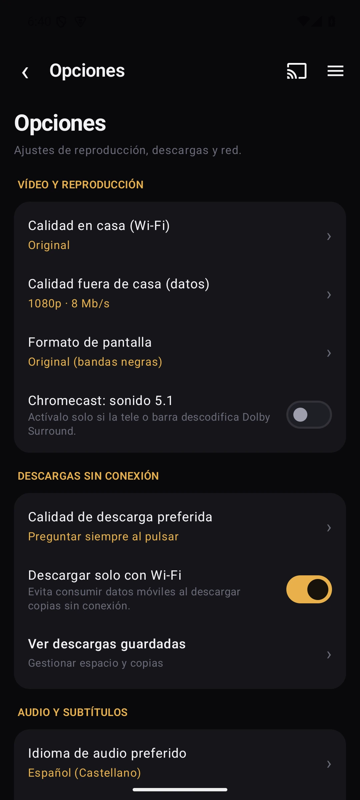 |
| *Interactive drag-and-drop section organization* | *Bitrate quality control, audio modes, and interface language selector* |

---

### Desktop Client (Windows, macOS & Linux — Electron + mpv)

Dedicated desktop player engineered for bit-perfect Direct Play, hardware video decoding, and uncompressed home cinema audio without server-side transcoding:

- **100% Direct Play**: Plays 4K HEVC Main 10, AV1, VP9, VC-1, DTS, DTS-HD MA, Dolby TrueHD, Dolby Atmos, FLAC, and graphic subtitles (PGS, ASS/SSA) natively via bundled mpv (`raw=1`).
- **Dedicated GPU Acceleration**: Zero CPU strain using hardware decoding on dedicated GPUs (Intel Arc QSV, NVIDIA NVDEC, AMD D3D11VA, Apple Silicon VideoToolbox, and Linux VA-API).
- **Modern libplacebo (`gpu-next`) Engine**: Native BT.2020 PQ HDR swapchain on Windows 11, Apple Liquid Retina XDR / EDR on macOS, and high-precision spline tone-mapping on SDR screens.
- **Audiophile Sound Modes**: Standard PCM, Bit-perfect Audio Raw (WASAPI and CoreAudio Exclusive), and HDMI Audio Passthrough (Bitstreaming to AV receivers and soundbars).
- **Desktop Integration**: Global media keys, transparent frameless overlay HUD (Windows/Linux) or native Metal window (macOS), trickplay scrub thumbnails, and seamless episode chaining.

---

## Hardware Requirements

One of the main design goals was efficiency: keeping resource usage low so you don't need expensive server gear.

### 1. Direct Play Mode (Local playback without transcoding)
When your TV, phone, or computer natively supports the video format (MKV/MP4 with H.264, HEVC, AV1, AAC, AC3, EAC3, TrueHD):
- **CPU**: Any 64-bit x86-64 processor (Intel Celeron J4125/N5105, Intel N100, or older Core i3/i5).
- **RAM**: **2 GB minimum** (the Node.js / Fastify process sits around ~120–200 MB in memory).
- **Storage**: ~300 MB for the server + 2 to 4 GB for local metadata, artwork cache, and SQLite database.
- **Network**: Gigabit Ethernet or 5 GHz Wi-Fi recommended for high-bitrate 4K remuxes (50–90 Mbps).

### 2. Real-Time Hardware Transcoding (GPU Accelerated)
When transcoding is required (burned subtitles, lower bandwidth outside home, or unsupported audio/video codecs):
- **Intel (Recommended / best efficiency)**:
  - Any 7th Gen (Kaby Lake) or newer Intel Core processor with UHD / Iris Xe Graphics using **Intel Quick Sync Video (QSV)**.
  - Dedicated Intel Arc GPUs (A380, A750, A770, or mobile Arc like A730M) or Intel Core Ultra (Meteor Lake / Arrow Lake) for hardware AV1 decoding & encoding.
- **NVIDIA**: Supported via **NVENC / NVDEC** (Turing, Ampere, Ada Lovelace, or Blackwell architectures).
- **AMD**: Supported via **AMF / VA-API** on Linux and Windows.

---

## Architecture & Core Features

- **Blazing Fast SQLite Backend**:
  - Powered by Node.js native `node:sqlite` in WAL (*Write-Ahead Logging*) mode.
  - Sub-5ms API response times for instant full-text search and dynamic filtering.
- **Adaptive Streaming & High-Performance Transcoding**:
  - *Direct Play*: Native stream passthrough with zero CPU utilization.
  - *Direct Stream / Remux*: Video stream copy with on-the-fly audio transcoding when device codecs require it.
  - *Hardware Acceleration*: GPU-accelerated transcoding via Intel Quick Sync (QSV), NVIDIA NVENC, AMD AMF, or CPU fallback. Both H.264 and HEVC codecs supported.
  - *Trickplay Scrubbing*: Keyframe thumbnail strips generated rapidly for timeline scrubbing.
- **Native Desktop Player (Windows, macOS & Linux)**:
  - Powered by Electron and an embedded native `mpv` video engine with Direct Play (`raw=1`), requiring zero server-side transcoding.
  - Dedicated hardware acceleration (Intel Arc QSV, NVIDIA NVDEC, AMD D3D11VA, Apple Silicon VideoToolbox, and Linux VA-API).
  - Modern `libplacebo` (`gpu-next`) rendering pipeline with native HDR, Apple Liquid Retina XDR / EDR, and high-quality tone mapping for SDR screens.
  - Audiophile sound options: Standard PCM, Bit-perfect Audio Raw (WASAPI and CoreAudio Exclusive), and HDMI Audio Passthrough (Bitstreaming to AV receivers).
  - Seamless integration: global media keyboard shortcuts, transparent frameless overlay HUD, trickplay thumbnails, and automatic episode chaining.
- **Watchlist & Cross-Device Progress**:
  - Unified per-profile Watchlist synchronized instantly across Web, Smart TV, Android, and Desktop.
  - Intelligent next-episode auto-play with countdown HUD.
  - Sleep timer for late-night viewing on Smart TVs.
  - High-resolution studio production logos preserving original brand colors.
- **Native Extra Featurettes & Behind-The-Scenes**:
  - Dedicated 16:9 extra rows integrated directly into media detail pages (*Behind the Scenes*, *Featurettes*, *Deleted Scenes*, *Interviews*, *Bloopers*, *Short Films*).
  - Optional automated downloading of official extras and trailers via TMDb and `yt-dlp`.
  - Floating ambient trailer preview on the Hero banner with smooth sound fade.
- **Intelligent Subtitles & Acoustic Synchronization**:
  - Real-time multilingual subtitle lookup (English & Spanish) querying OpenSubtitles and SubSource.
  - Automatic acoustic synchronization using cross-correlation against the center audio channel.
  - Floating in-player HUD for live subtitle delay and offset adjustment.
  - Local AI transcription via Whisper for media files lacking subtitles.
  - On-the-fly OCR converting bitmap PGS subtitles to WebVTT on Smart TVs.
- **Acoustic Optimization & Night Listening Modes**:
  - *Dialogue Clarity*: Intelligent acoustic enhancement boosting the center vocal frequency range.
  - *Night Mode*: Dynamic range compression leveling whispers and softening loud explosions.
- **3D Collector's Edition Packaging**:
  - Interactive 3D Steelbook view with extractable physical disc (discart) and high-definition fullscreen viewer.
- **Dedicated Samsung Smart TV (Tizen) App**:
  - Precision orthogonal D-pad spatial navigation.
  - Interactive "Grab & Drop" sidebar customizer (`[OK]` to pick up, move, and drop).
  - Automated TV intro/theme detection via Chromaprint acoustic fingerprints and automated credits detection.
- **Multi-Language Interface Support**:
  - English is enabled by default on all fresh installations and clones.
  - Seamlessly toggle between **English** and **Spanish** in any client (Web, Smart TV, Android, and Desktop).

---

## Project Structure

| Directory | Component | Stack |
|---|---|---|
| `server/` | REST API Server & Streaming Engine | Node.js + TypeScript (Fastify) + SQLite (`node:sqlite`) |
| `web/` | Web Client | React 19 + Vite 6 + Tailwind CSS 4 + Motion |
| `tv/` | Smart TV Client (Samsung Tizen) | Plain TypeScript + ES2016 IIFE + AVPlay native |
| `android/` | Android Mobile / Tablet / Cast | Kotlin + Jetpack Compose + Media3 (ExoPlayer) + Google Cast |
| `desktop/` | Native Desktop Client (Windows, macOS & Linux) | Electron 44 + Embedded mpv + Direct3D 11 / VideoToolbox / VA-API Hardware Decoding |
| `data/` | Local runtime data (git-ignored) | SQLite database, generated artwork cache, trickplay thumbnails |

---

## Prerequisites (for manual source installation)

1. **Node.js**: Version 22 or higher (Node 26 executes TypeScript directly without a build step).
2. **FFmpeg & FFprobe**: Configured with support for common codecs (H.264, HEVC) and GPU acceleration (Intel QSV, VAAPI, or NVIDIA NVENC).
3. **Python 3.10+**: Used for subtitle acoustic synchronization utilities (`subtitles_api.py`, `subsfetch.py`).
4. **yt-dlp**: Optional, used for fetching official extra featurettes to disk.

---

## Getting Started from Source

### 1. Clone the repository
```bash
git clone https://github.com/pacotegg/mediawatch.git
cd mediawatch
```

### 2. Install dependencies
```bash
npm install
```

### 3. Initial Configuration
Create `data/config.json` with your movie and TV series directories:
```json
{
  "port": 8730,
  "libraries": [
    { "name": "Movies", "path": "D:\\Media\\Movies", "kind": "movie" },
    { "name": "TV Shows", "path": "D:\\Media\\TVShows", "kind": "show" }
  ],
  "ffmpeg": "ffmpeg",
  "ffprobe": "ffprobe",
  "python": "python"
}
```

### 4. Scan library
```bash
npm run scan
```

### 5. Launch the server
```bash
npm start
```
Access the web client locally at `http://localhost:8730` or over your local network at `http://<server-ip>:8730`.

---

## Client Applications & Building

> 💡 **Looking for ready-to-use client apps without compiling?**  
> You don't need to build from source! If you just want to enjoy your media:
> - **Desktop (Windows, macOS & Linux)**: Download the ready-to-run installers directly from **[Releases](https://github.com/pacotegg/mediawatch/releases)** or your server's `/instalar.html` page.
> - **Android (Phone / Tablet / Cast)**: Download the `.apk` package directly from your server's `/instalar.html` page or from Releases.
> - **iPhone & iPad**: Open the web app in Safari, tap *Share* (icon ⎋), and select *«Add to Home Screen»*.
> 
> *Follow the step-by-step guides below only if you are developing or compiling the client applications yourself from source.*

---

### 1. Desktop Client (Windows, macOS & Linux)

The native desktop client is built on **Electron** with an embedded **mpv** playback engine for bit-perfect Direct Play without server-side transcoding.

#### A. Windows 10 / 11
1. Navigate to the desktop directory and install dependencies:
   ```bash
   cd desktop
   npm install
   ```
2. Build the Windows installer:
   ```bash
   npm run dist
   ```
   *What does this command do?* It automatically downloads a verified `mpv` binary (validated against a fixed SHA-256 hash), compiles the TypeScript code, and creates the NSIS `.exe` installer in `desktop/release/MediaWatch-Escritorio-Setup-<version>.exe`. Simply run the installer to set up the app.

#### B. macOS (Apple Silicon M1–M4 & Intel)
1. Install `mpv` on your Mac if you haven't already (using [Homebrew](https://brew.sh/)):
   ```bash
   brew install mpv
   ```
2. Navigate to the desktop directory and build the Universal package:
   ```bash
   cd desktop
   npm install
   npm run dist:mac
   ```
   *Result*: Generates `MediaWatch-Escritorio-<version>-mac.dmg` in `desktop/release/`. Open the disk image and drag **Media Watch** into your `Applications` folder.
   > ℹ️ **Note for macOS (Gatekeeper)**: The first time you launch the app, **Control + Click** (right-click) the application icon in Finder and select **Open** to confirm the Apple security prompt (or run `xattr -cr /Applications/Media\ Watch.app` in Terminal).

#### C. Linux (Ubuntu, Debian, Fedora, Arch, etc.)
1. Ensure `mpv` is installed via your package manager:
   ```bash
   sudo apt install mpv    # Debian / Ubuntu / Linux Mint
   sudo dnf install mpv    # Fedora
   sudo pacman -S mpv      # Arch Linux
   ```
2. Build the Linux packages:
   ```bash
   cd desktop
   npm install
   npm run dist:linux
   ```
   *Result*: Creates both a universal standalone `.AppImage` and a `.deb` package in `desktop/release/`. To run the AppImage:
   ```bash
   chmod +x desktop/release/MediaWatch-Escritorio-*.AppImage
   ./desktop/release/MediaWatch-Escritorio-*.AppImage
   ```

---

### 2. Web Client & Development Environment

- **Build for production**:
  ```bash
  npm run build
  ```
  Compiles the optimized static assets into `web/dist/`, which are automatically served by the Fastify backend without any extra web server setup.
- **Development mode (Hot Reload)**:
  ```bash
  npm run dev
  ```
  Runs the backend API alongside the Vite development server with instant Hot Module Replacement (HMR) when editing React components.

---

### 3. Samsung Smart TV (Tizen 5.0+ / 2019+ Models)

You don't need to install the heavy 5 GB Tizen Studio IDE on your computer: we build, package, and install the `.wgt` app directly to your TV over the local network using a Docker container.

#### Step 1: Enable Developer Mode on your Samsung TV
1. On your TV remote, press the **Home** button and navigate to **Apps**.
2. Using the remote control number pad (or virtual number pad), press: `1`, `2`, `3`, `4`, `5`.
3. A hidden popup labeled **Developer Mode** will appear.
4. Toggle Developer Mode to **ON** and enter your computer's local network IP address in the **Host PC IP** field (e.g., `192.168.1.50`).
5. Click *OK* and **reboot your TV** by holding down the power button on the remote for 3 seconds until the Samsung logo appears.

#### Step 2: Build and deploy the application
1. Compile the Smart TV bundle from the repository root:
   ```bash
   npm run build --workspace tv
   ```
2. Run the Docker container to package and install the application to your TV (replace `<TV_IP>` with your Samsung TV's local IP address):
   ```bash
   MSYS_NO_PATHCONV=1 docker run --rm --network host -v "${PWD}/tv:/app" \
     --entrypoint sh ghcr.io/georift/install-jellyfin-tizen:latest -c '
   export PATH=$PATH:/tizen-studio/tools:/tizen-studio/tools/ide/bin
   sdb connect <TV_IP>:26101
   TELE=$(sdb devices | grep -v "List of" | awk "{print \$3}" | head -1)
   mkdir -p /build && cp -r /app/dist/* /build/ && cd /build
   tizen build-web -- /build >/dev/null 2>&1
   tizen package -t wgt -s dev -- /build/.buildResult
   mv "/build/.buildResult/Media Watch.wgt" "/build/.buildResult/MediaWatch.wgt" 2>/dev/null || true
   tizen install -n MediaWatch.wgt -t "$TELE" -- /build/.buildResult
   '
   ```
   The **Media Watch** app will now appear installed on your TV's home bar.

---

### 4. Android App (Mobile, Tablet & Google Cast)

#### Prerequisites
- **JDK 17** installed and configured in your `JAVA_HOME` environment variable (e.g., [Eclipse Adoptium Temurin 17](https://adoptium.net/temurin/releases/?version=17) or Android Studio).

#### Building
1. Navigate to the Android directory:
   ```bash
   cd android
   ```
2. Build the release APK:
   - On **Linux / macOS**:
     ```bash
     ./gradlew :app:assembleRelease
     ```
   - On **Windows**:
     ```powershell
     .\gradlew.bat :app:assembleRelease
     ```
3. The compiled `.apk` binary will be located at:
   ```text
   android/app/build/outputs/apk/release/app-release.apk
   ```
4. To install it directly to a USB-connected device with ADB debugging enabled:
   ```bash
   adb install -r app-release.apk
   ```
   Or transfer the file directly to your phone via USB cable, cloud storage, or email and open it.

---

## Support the Project

If you find Media Watch useful and want to help support ongoing development, consider [buying me a coffee on Ko-fi](https://ko-fi.com/pacotegg). Every contribution is greatly appreciated!

---

## License

Media Watch is licensed under the **GNU General Public License v3.0**. See the [LICENSE](LICENSE) file for more details.
