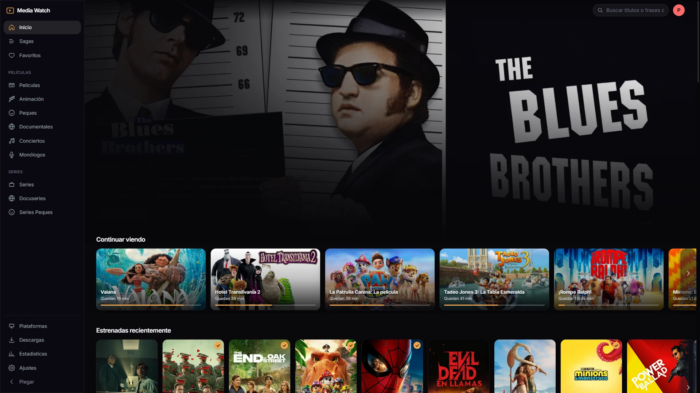
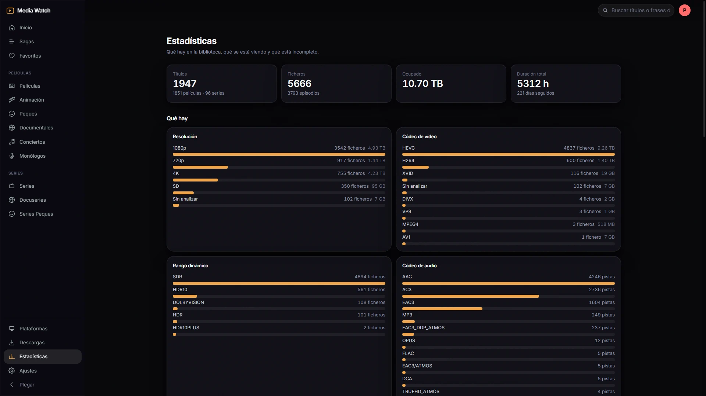
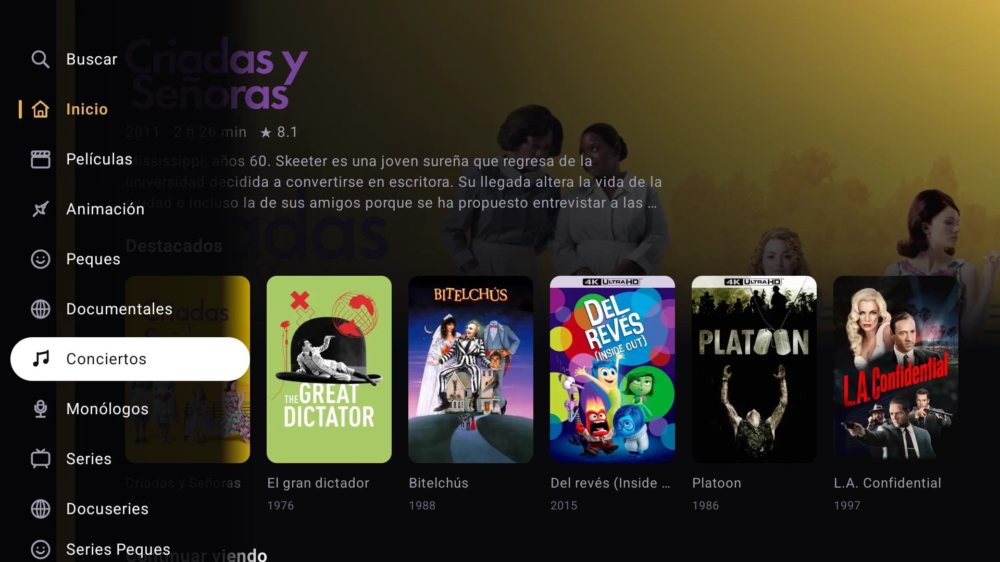
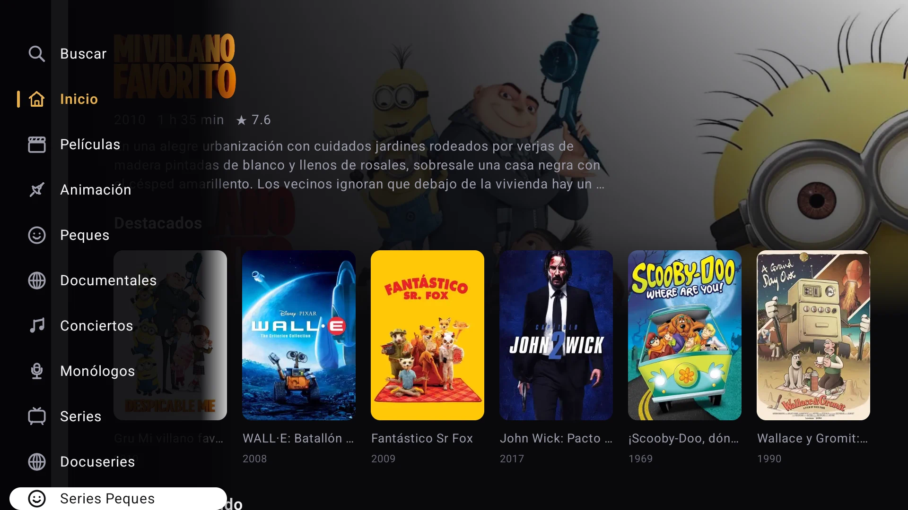
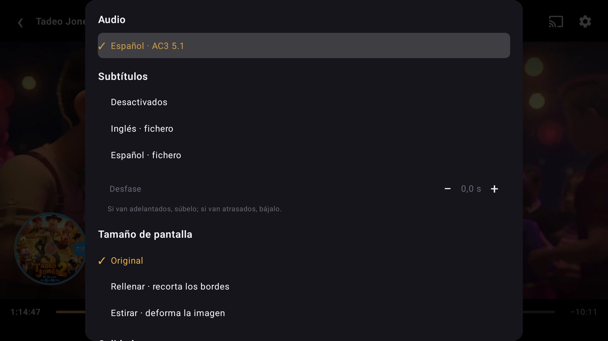
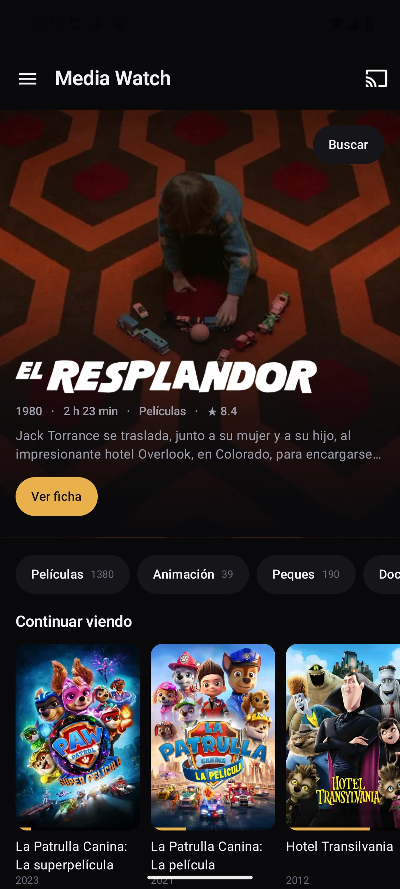
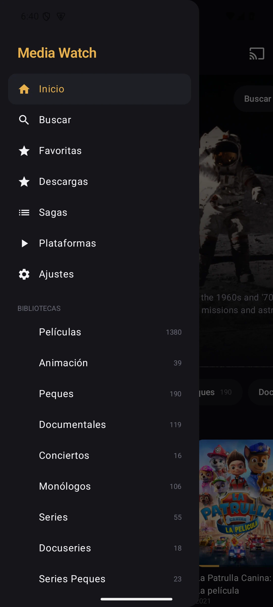
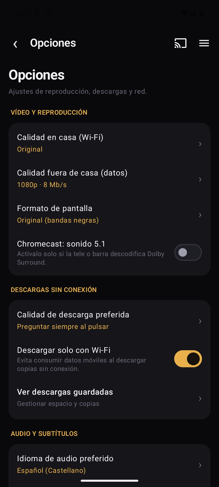

# Media Watch

[](LICENSE)
[](https://nodejs.org/)
[](#client-applications--building)
[](https://github.com/pacotegg/MediaWatch-Server)
[](https://ko-fi.com/pacotegg)

[English](README.md) · [Español](README.es.md)

> ☕ **Enjoying Media Watch?** If you'd like to support ongoing development, you can [buy me a coffee on Ko-fi](https://ko-fi.com/pacotegg) or use the **Sponsor** button above!

I built Media Watch for my living room HTPC setup because I wanted a clean, fast streaming server that feels like a premium home cinema experience — without telemetry, cloud user accounts, or subscription paywalls.

It reads your media library directly from your storage drives, indexes your metadata and artwork, and streams to your TV, phone, tablet, or browser. If your player supports the file, it Direct Plays untouched with virtually 0% CPU. If you need transcoding (subtitles, lower bitrates outside home, or unsupported codecs), it uses your GPU hardware acceleration.

> 💡 **Looking for a ready-to-run desktop installer?**  
> Check out **[MediaWatch Server](https://github.com/pacotegg/MediaWatch-Server)**: a standalone desktop application for **Windows** and **Linux** with system tray controls, automatic TMDb metadata scraping without needing pre-existing `.nfo` files, and an instant QR code pairing tool. This repository (`pacotegg/mediawatch`) is the core engine.

---

## GNU General Public License v3.0

Media Watch is free and open-source software: you can redistribute it and/or modify it under the terms of the **GNU General Public License version 3.0 (GPLv3)** as published by the Free Software Foundation. See [LICENSE](LICENSE) for details.

---

## Visual Showcase

### Web Client (React 19 + Tailwind CSS)

| Interactive Home & Hero Banner | Media Details & 3D Steelbook |
|:---:|:---:|
|  |  |
| *Hero banner with trailer playback, resume carousel & collections* | *Stream badges, Rotten Tomatoes/IMDb ratings, 3D discart & native 16:9 extras* |

| Poster Grid Library Browsing | Playback Analytics & Statistics |
|:---:|:---:|
|  |  |
| *Instant metadata search, filtering, and responsive poster grid* | *Playback statistics, hourly activity, and device tracking* |

---

### Samsung Smart TV (Tizen)

| Big-Screen TV Interface | Customizable Sidebar Menu |
|:---:|:---:|
|  |  |
| *Designed for fluid 60 FPS spatial navigation with remote control D-pad* | *Grab & Drop menu reordering to prioritize your favorite libraries* |

| TV Library Grid | AVPlay Native Player HUD |
|:---:|:---:|
|  |  |
| *Large-format TV catalog navigation* | *Trickplay thumbnail scrubbing, subtitle offset HUD & acoustic modes* |

---

### Android Mobile, Tablet & Google Cast

| Mobile Feed | Rich Media Details & Offline Downloads |
|:---:|:---:|
|  |  |
| *Jetpack Compose feed with quick resume cards* | *Direct download profiles, audio track switcher, and trailer viewer* |

| Grab & Drop Navigation Drawer | Detailed Application Settings |
|:---:|:---:|
|  |  |
| *Interactive drag-and-drop section organization* | *Bitrate quality control, audio modes, and interface language selector* |

---

## Hardware Requirements

One of the main design goals was efficiency: keeping resource usage low so you don't need expensive server gear.

### 1. Direct Play Mode (Local playback without transcoding)
When your TV, phone, or computer natively supports the video format (MKV/MP4 with H.264, HEVC, AV1, AAC, AC3, EAC3, TrueHD):
- **CPU**: Any 64-bit x86-64 processor (Intel Celeron J4125/N5105, Intel N100, or older Core i3/i5).
- **RAM**: **2 GB minimum** (the Node.js / Fastify process sits around ~120–200 MB in memory).
- **Storage**: ~300 MB for the server + 2 to 4 GB for local metadata, artwork cache, and SQLite database.
- **Network**: Gigabit Ethernet or 5 GHz Wi-Fi recommended for high-bitrate 4K remuxes (50–90 Mbps).

### 2. Real-Time Hardware Transcoding (GPU Accelerated)
When transcoding is required (burned subtitles, lower bandwidth outside home, or unsupported audio/video codecs):
- **Intel (Recommended / best efficiency)**:
  - Intel Core 7th Gen (Kaby Lake, 2017+) or newer with **Intel UHD / HD 600+** graphics. Budget chips like **Intel N100 / N95 / N200** transcode 4K HDR down to 1080p effortlessly via **Quick Sync (QSV)**.
  - Dedicated **Intel Arc** GPUs (A310, A380, A750, A770).
- **NVIDIA**:
  - GeForce **GTX 1050 or higher**, GTX 1650/1660, or any **RTX series (20xx/30xx/40xx/50xx)** with NVENC encoder.
- **AMD**:
  - Ryzen APUs with Vega / RDNA integrated graphics, or dedicated Radeon RX 400 series or newer (AMF encoder).
- **RAM**: **4 GB or more**.

### 3. Software Transcoding (CPU Only, without GPU)
- **CPU**: 4 cores / 8 threads minimum for real-time 1080p transcoding.  
  *(Honest note: Software transcoding 4K HDR on CPU will pin all cores to 100% and will likely stutter; use hardware GPU acceleration for 4K).*

---

## Hardware Transcoding: H.264 & HEVC / x265

Media Watch includes hardware-accelerated encoding for both **H.264 (AVC)** and **HEVC (H.265)**:

| Hardware Engine | H.264 Encoder | HEVC (x265) Encoder | HDR Tonemapping |
|---|---|---|---|
| **Intel Quick Sync (QSV)** | `h264_qsv` | `hevc_qsv` (native 10-bit HDR) | `vpp_qsv` (GPU tonemap) |
| **NVIDIA NVENC** | `h264_nvenc` | `hevc_nvnv` | Hardware scale + tonemap |
| **AMD AMF** | `h264_amf` | `hevc_amf` | Hardware scale |
| **CPU Fallback** | `libx264` | `libx265` | Software tonemap |

### Choosing between H.264 and HEVC in Settings:
- **H.264 (Default)**: Maximum universal compatibility. Every web browser (Firefox on Linux/Windows, Chromium browsers without HEVC licenses, old laptops) can play H.264 out of the box without black screens.
- **HEVC / H.265**: Saves roughly 40–50% bandwidth at identical visual quality and supports 10-bit HDR color natively on GPU. Recommended if your main playback devices are the Android app, Samsung Smart TV, or browsers with hardware HEVC decoding enabled (Edge, Safari, Chrome with OS hardware decoders).
- Change it anytime under **Settings &rarr; Transcoding &rarr; Transcode Codec**.

---

## Linux Support & Requirements

Media Watch runs smoothly on Linux (Ubuntu, Debian, Fedora, Arch, etc.). When hosting on Linux:

### 1. Standalone Desktop App (via MediaWatch Server)
- **AppImage**: Runs directly without installation.
  - *Requirement on modern distros (Ubuntu 22.04+, Debian 12, Fedora)*: ensure FUSE 2 is installed:
    ```bash
    sudo apt install libfuse2
    ```
- **DEB Package**: Native installation for Debian, Ubuntu, and Linux Mint:
  ```bash
  sudo dpkg -i mediawatch-server_*_amd64.deb
  ```

### 2. Hardware Acceleration on Linux
- **Intel QSV / VAAPI**:
  - Install the non-free media driver:
    ```bash
    sudo apt install intel-media-va-driver-non-free vainfo
    ```
  - Ensure your user has access to the render node:
    ```bash
    sudo usermod -aG render,video $USER
    ```
  - Verify with `vainfo`: you should see `VAProfileH264...` and `VAProfileHEVC...` entrypoints.
- **NVIDIA NVENC**:
  - Install the official proprietary NVIDIA drivers (`nvidia-driver-xxx`). Verify with `nvidia-smi`.

---

## Core Features

- **100% Zero-Cloud Local Cataloging**:
  - Scans thousands of titles in seconds directly from local `.nfo` files, posters, fanarts, and backdrops.
  - Automatic film collections and chronological sagas built locally without third-party network calls.
  - Optional on-demand enrichment via TMDb/OMDb when requested (no unwanted automatic metadata overwrites).
- **Adaptive Streaming & High-Performance Transcoding**:
  - *Direct Play*: Native stream passthrough with zero CPU utilization.
  - *Direct Stream / Remux*: Video stream copy with on-the-fly audio transcoding when device codecs require it.
  - *Hardware Acceleration*: GPU-accelerated transcoding via Intel Quick Sync (QSV), NVIDIA NVENC, AMD AMF, or CPU fallback. Both H.264 and HEVC codecs supported.
  - *Trickplay Scrubbing*: Keyframe thumbnail strips generated rapidly for timeline scrubbing.
- **Native Extra Featurettes & Behind-The-Scenes**:
  - Dedicated 16:9 extra rows integrated directly into media detail pages (*Behind the Scenes*, *Featurettes*, *Deleted Scenes*, *Interviews*, *Bloopers*, *Short Films*).
  - Optional automated downloading of official extras and trailers via TMDb and `yt-dlp`.
  - Floating ambient trailer preview on the Hero banner with smooth sound fade.
- **Intelligent Subtitles & Acoustic Synchronization**:
  - Real-time multilingual subtitle lookup (English & Spanish) querying OpenSubtitles and SubSource.
  - Automatic acoustic synchronization using cross-correlation against the center audio channel.
  - Floating in-player HUD for live subtitle delay and offset adjustment.
  - Local AI transcription via Whisper for media files lacking subtitles.
  - On-the-fly OCR converting bitmap PGS subtitles to WebVTT on Smart TVs.
- **Acoustic Optimization & Night Listening Modes**:
  - *Dialogue Clarity*: Intelligent acoustic enhancement boosting the center vocal frequency range.
  - *Night Mode*: Dynamic range compression leveling whispers and softening loud explosions.
- **3D Collector's Edition Packaging**:
  - Interactive 3D Steelbook view with extractable physical disc (discart) and high-definition fullscreen viewer.
- **Dedicated Samsung Smart TV (Tizen) App**:
  - Precision orthogonal D-pad spatial navigation.
  - Interactive "Grab & Drop" sidebar customizer (`[OK]` to pick up, move, and drop).
  - Automated TV intro/theme detection via Chromaprint acoustic fingerprints and automated credits detection.
- **Multi-Language Interface Support**:
  - English is enabled by default on all fresh installations and clones.
  - Seamlessly toggle between **English** and **Spanish** in any client (Web, Smart TV, and Android).

---

## Project Structure

| Directory | Component | Stack |
|---|---|---|
| `server/` | REST API Server & Streaming Engine | Node.js + TypeScript (Fastify) + SQLite (`node:sqlite`) |
| `web/` | Web Client | React 19 + Vite 6 + Tailwind CSS 4 + Motion |
| `tv/` | Smart TV Client (Samsung Tizen) | Plain TypeScript + ES2016 IIFE + AVPlay native |
| `android/` | Android Mobile / Tablet / Cast | Kotlin + Jetpack Compose + Media3 (ExoPlayer) + Google Cast |
| `data/` | Local runtime data (git-ignored) | SQLite database, generated artwork cache, trickplay thumbnails |

---

## Prerequisites (for manual source installation)

1. **Node.js**: Version 22 or higher (Node 26 executes TypeScript directly without a build step).
2. **FFmpeg & FFprobe**: Configured with support for common codecs (H.264, HEVC) and GPU acceleration (Intel QSV, VAAPI, or NVIDIA NVENC).
3. **Python 3.10+**: Used for subtitle acoustic synchronization utilities (`subtitles_api.py`, `subsfetch.py`).
4. **yt-dlp**: Optional, used for fetching official extra featurettes to disk.

---

## Getting Started from Source

### 1. Clone the repository
```bash
git clone https://github.com/pacotegg/mediawatch.git
cd mediawatch
```

### 2. Install dependencies
```bash
npm install
```

### 3. Initial Configuration
Create `data/config.json` defining your server port and media folders:
```json
{
  "port": 8730,
  "libraries": [
    { "name": "Movies", "path": "D:\\Media\\Movies", "kind": "movie" },
    { "name": "TV Shows", "path": "D:\\Media\\TVShows", "kind": "show" }
  ],
  "ffmpeg": "ffmpeg",
  "ffprobe": "ffprobe",
  "python": "python"
}
```

### 4. Scan your media library
Scan and index local `.nfo` metadata and artwork:
```bash
npm run scan
```

### 5. Launch the server
```bash
npm start
```
The server will be reachable at:
- Local machine: `http://localhost:8730`
- Local network: `http://<your-server-ip>:8730`

For frontend live-reload development (server + web):
```bash
npm run dev
```

---

## Client Applications & Building

### Web & Smart TV
```bash
npm run build
```
Builds static bundles to `web/dist/` (served directly by the backend) and `tv/dist/`.

### Samsung Smart TV (Tizen)
Package and install the `.wgt` application to your Samsung TV using Docker:
```bash
MSYS_NO_PATHCONV=1 docker run --rm --network host -v "${PWD}/tv:/app" \
  --entrypoint sh ghcr.io/georift/install-jellyfin-tizen:latest -c '
export PATH=$PATH:/tizen-studio/tools:/tizen-studio/tools/ide/bin
sdb connect <TV_IP>:26101
TELE=$(sdb devices | grep -v "List of" | awk "{print \$3}" | head -1)
mkdir -p /build && cp -r /app/dist/* /build/ && cd /build
tizen build-web -- /build >/dev/null 2>&1
tizen package -t wgt -s dev -- /build/.buildResult
mv "/build/.buildResult/Media Watch.wgt" "/build/.buildResult/MediaWatch.wgt" 2>/dev/null || true
tizen install -n MediaWatch.wgt -t "$TELE" -- /build/.buildResult
'
```

### Android App
```bash
cd android
./gradlew :app:assembleRelease
```
The compiled APK will be generated at `android/app/build/outputs/apk/release/`.

---

## Controls & Keybindings

### Web Player Shortcuts

| Key | Action |
|---|---|
| `Space` / `K` | Play / Pause |
| `←` / `→` | Short seek (10–15 s configurable) |
| `Shift` + `←` / `→` | Long seek (60 s) |
| `↑` / `↓` | Volume control |
| `F` | Toggle fullscreen |
| `M` | Mute / Unmute audio |
| `G` / `H` | Adjust subtitle delay (-50 ms / +50 ms) |
| `C` | Toggle subtitles |
| `Esc` | Exit player |
| `/` | Focus search bar (when outside player) |

### Smart TV Remote Control (Tizen)

- **D-Pad (`▲ / ▼ / ◄ / ►`)**: Fluid orthogonal spatial navigation across media cards and carousels.
- **`[ENTER / OK]`**: Select title, play, or pause.
- **Grab & Drop Menu Reordering**: In Settings → *Customize menu*, press `[OK]` to grab any section, move it up or down using `[▲ / ▼]`, and press `[OK]` again to release. Press `[►]` to toggle visibility.
- **`[BACK]`**: Return to previous screen or dismiss menus.

---

## Support the Project

If you enjoy using Media Watch and want to support its ongoing development, you can [buy me a coffee on Ko-fi](https://ko-fi.com/pacotegg). Every contribution is deeply appreciated!

---

## License

Media Watch is licensed under the **GNU General Public License v3.0**. See the [LICENSE](LICENSE) file for complete details.
